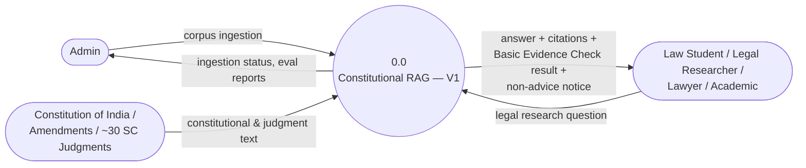
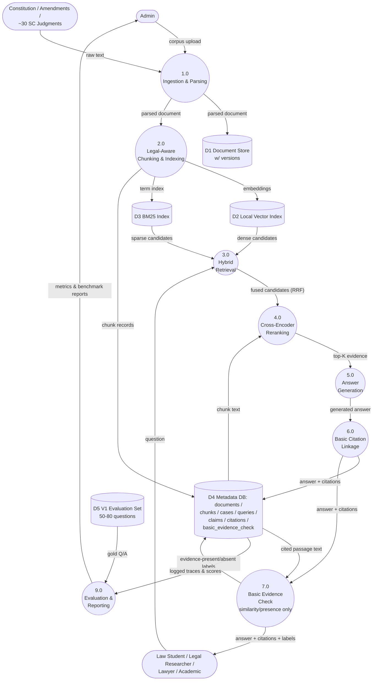
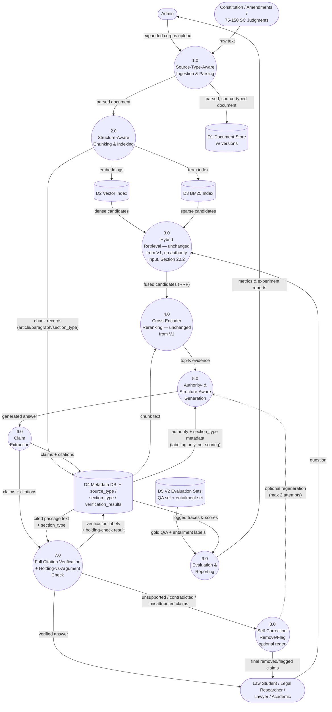
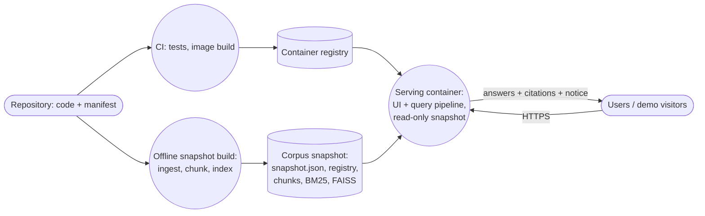

# 1. Title Page

**Constitutional Evidence RAG**
**Hybrid Legal RAG with Claim-Level Citation Verification for Indian Constitutional Law**

| Field | Value |
|---|---|
| Document Version | 4.3 (consolidated: v4.1 + v4.2 amendment + deployment requirements) |
| Derived From | Constitutional Evidence RAG SRS v4.1 and SRS v4.2 Amendment |
| Supersedes | SRS v4.1 and the SRS v4.2 Amendment. This single document is now authoritative; the earlier two are kept only as history. |
| Project Type | AI/ML · Information Retrieval · Legal Informatics · Software Engineering |
| Primary Domain | Indian Constitutional Law — legal research assistance |
| Status | Implementation-ready |
| Project Composition | ~70–75% engineering/product (V1) · ~25–30% focused research (V2) |

---

# 2. Version History

| Version | Change |
|---|---|
| 1.0 | Initial legal-domain SRS; full verification framework specified as v1 scope. |
| 2.0 | Restructured into V1 → V2 phasing. |
| 3.0 | Audited for scope creep, V1/V2 boundary leakage, terminology ambiguity, unrealistic dataset/annotation load, and unjustified infrastructure complexity. |
| 4.0 | Re-organized into a 47-section implementation-ready SRS format. No change to research direction, scope boundaries, or requirements substance from v3.0 — this version reorganizes, expands cross-references (use cases, error taxonomy, deployment, ethics), and tightens requirement acceptance criteria. Every v3.0 correction is preserved and is traceable below. |
| 4.1 | **Scope and implementation audit** to bring the project to a deliberate ~70–75% engineering / ~25–30% research composition. No redesign: architecture, pipeline, terminology, and the C vs. D experiment are unchanged. Changes are limited to (a) reducing the V2 corpus and evaluation-set targets, (b) consolidating V2's research questions into one primary RQ with the rest as secondary metrics, (c) simplifying a small number of overly implementation-specific acceptance criteria, and (d) restructuring milestones/success criteria so V1 is explicitly a complete, demonstrable product on its own and V2 is explicitly framed as a research extension, not a prerequisite. See the **Final Changes Made** section at the end of this document for the complete, itemized list. |
| 4.2 | **Scope-boundary amendment** (issued separately as the "SRS v4.2 Amendment", now merged into this document). User-provided document uploads and user document collections are explicitly V2. V1 is restricted to a single curated corpus (Constitution + ~30 curated judgments) and gains an explicit OCR fallback requirement (FR-02a). The document model gains a `corpus_id`, so V1 ingestion, storage and retrieval interfaces are corpus-generic (FR-01a, FR-05a). The research design (RQ1–RQ3, Experiments A–D), terminology, authority model and out-of-scope list are unchanged, except for the clarifications recorded in Appendix C. |
| 4.3 | **Consolidation and deployment.** (a) Merges the v4.2 amendment into the body of the SRS, so one document is authoritative. (b) Adds deployment as a requirement: deployment objectives (§6.3), three deployment profiles (local, hosted public demo, private hosted), build/serve separation through a versioned corpus snapshot artifact, FR-DEP-01–13, NFR-11–15, deployment use cases (UC-13–16), risks 20–26, milestones DEP-1–DEP-3, deliverables 22–26, and a rewritten §40. (c) Aligns §40 with the single-container SQLite default (§39). No change to the research design. See Appendix D. |

### Corrections Carried Forward from v3.0 (authoritative — do not re-introduce these issues)

| # | Issue | Resolution (still binding in v4.0) |
|---|---|---|
| 1 | V1's evidence check quietly included NLI, duplicating V2's contribution. | V1 uses **Basic Evidence Check** only (similarity/presence, no NLI); never called "verification." |
| 2 | Experiment D was defined inconsistently. | D = **Experiment C + full claim-level verification**, compared only against C. |
| 3 | Source authority language implied it could affect ranking. | Authority is a **labeling/provenance dimension only**; never modifies retrieval or reranking scores. |
| 4 | "Holding," "ratio," "argument," "obiter," "section type" used inconsistently. | Fixed terminology box (Section 19). |
| 5 | Corpus/eval-set targets stated as hard floors. | Stated as **ranges with acceptable partial completion**. |
| 6 | LLM-as-judge treated as a required V2 signal. | **Optional / tie-breaker only.** |
| 7 | Self-correction specified as mandatory regeneration. | **Claim removal/flagging is required**; regeneration (max 2 attempts) is an enhancement. |
| 8 | Schema introduced tables not yet justified at MVP scale. | `source_versions` and `constitutional_articles` folded into `documents`/`chunks`. |
| 9 | Qdrant fixed as a requirement even for the small V1 corpus. | Local FAISS/Chroma recommended for V1; Qdrant is a config choice if V2 scale needs it. |
| 10 | Metrics listed without mapping to research questions. | Explicit RQ → Metric table (Section 35). |
| 11 | Pipeline diagrams drifted from prose descriptions. | One canonical V1 pipeline, one canonical V2 extension (Sections 25–28, 47). |
| 12 | Verified output could read as a claim of legal correctness. | **Evidence support ≠ legal correctness** restated in Sections 4, 28, 38, 42. |

---

# 3. Executive Summary

Constitutional Evidence RAG is a two-phase, research-oriented question-answering system for Indian Constitutional Law.

**V1** builds a complete, usable evidence-grounded RAG pipeline — hybrid dense+BM25 retrieval with cross-encoder reranking, over the Constitution of India and a curated set of ~30 Supreme Court constitutional judgments (30–50 acceptable) — and answers a single question: *can the system reliably retrieve and present the correct legal evidence?*

**V2** adds the project's central research contribution: a claim-level citation verification layer that checks whether the evidence a generated answer cites actually supports the claim made, including a dedicated check for the specific and legally serious failure of citing a party's argument as if it were the Court's holding.

V2 also adds **user document collections**: a user may upload their own legal PDFs into a named collection and query that collection. Collections are ingested by the same pipeline as the curated corpus, and answers over them are verified by the same claim-level verification layer. Collections are a product extension. They are not part of the V2 research question (RQ3), which is evaluated on the curated corpus only.

The system is deliberately scoped as a **research tool**, not a legal assistant, an advice generator, or an outcome predictor. Its output is always evidence plus a support judgment — never a legal conclusion.

**Positioning.** Constitutional Evidence RAG is an evidence-grounded legal research tool for Indian Constitutional Law. V1 provides hybrid retrieval, reranking, evidence-grounded generation, and inspectable citations, and stands on its own as a usable product. V2 extends the system with claim-level citation verification to assess whether generated claims are actually supported by their cited evidence. The project is deliberately weighted as **~70–75% engineering/product work (V1)** and **~25–30% focused research (V2)**: V2 adds one clean, well-scoped research contribution inside a working product, rather than turning the project into an academic NLI study. It is demonstrable live, publishable on GitHub, explainable in a technical interview end-to-end, and buildable by a small student team without disproportionate research overhead — while still leaving a clear path to a research paper if the team chooses to pursue one.

**Deployment.** The system ships as one container image that runs unchanged on a developer machine and on a single hosting target. V1 is published as a **hosted, public, read-only demo** over the curated corpus. The demo serves a prebuilt, versioned corpus snapshot and never ingests or indexes on its serving path. User document collections (V2) run only in local or access-restricted private deployments, never on the public demo (§40).

---

# 4. Problem Statement

**V1 problem.** Constitutional legal queries mix two retrieval demands: exact references (article numbers, case names, quoted phrases) and semantic/doctrinal phrasing ("how has the Court read Article 14"). A retrieval system tuned for only one of these will systematically fail the other. Before any downstream claim or citation can be trusted, the system must first be shown to retrieve well across both query types.

**V2 problem.** Even accurate retrieval does not guarantee that a generated answer's citations actually support what the answer claims. Two independent failure modes exist: (a) the cited passage is topically related but does not establish the specific proposition claimed, and (b) the generation step misattributes a passage's legal function — most seriously, presenting a party's submission as though it were the Court's determination. V2 exists to detect these two failure modes specifically, not to adjudicate whether a legal claim is *correct*.

**Standing constraint across both phases:** evidentiary support is not legal correctness. Confirming that a passage textually supports a claim is not the same as confirming the claim is good law, and the system must never be read as doing the latter.

---

# 5. Motivation

Legal research is citation-dependent: a claim without a locatable, inspectable source is close to worthless to a researcher, and a claim with a *misleading* source is worse than no claim at all, because it looks trustworthy. General-purpose LLMs answer confidently and cite loosely, which is precisely the wrong failure mode for legal text. This project treats citation verification as a first-class research problem — not a UI nicety — and deliberately separates "did we retrieve the right evidence" (V1) from "does the evidence we cited actually hold up" (V2), so that each question can be evaluated on its own and the second doesn't get credit or blame for the first.

---

# 6. Objectives

### 6.1 V1 Objectives

1. Ingest and parse the Constitution of India, relevant amendment material, and a curated set of ~30 Supreme Court constitutional judgments (30–50 acceptable), forming the single curated V1 corpus. The ingestion/chunking design must scale to ~75 without rework, and must be generic over the target corpus so that V2 can ingest user collections without rewriting it.
2. Chunk sources into retrievable units carrying legal provenance (article number, case name, paragraph number, page) as first-class metadata.
3. Build dense and BM25 indices suited to a corpus mixing exact legal terminology with discursive legal reasoning.
4. Perform hybrid retrieval (RRF) and cross-encoder reranking, evaluated incrementally as Experiments A/B/C.
5. Generate answers using an LLM constrained to supplied evidence, with structured claim/citation output.
6. Attach a citation to every material claim with enough metadata to locate the source passage.
7. Apply a **Basic Evidence Check** (similarity/presence only — no NLI) per citation.
8. Present answers in a usable web UI carrying the non-advice notice at all times.
9. Evaluate retrieval and answer quality on a manually curated 50–80 question set.

### 6.2 V2 Objectives (additive)

10. Expand the corpus toward 75–150 judgments (~100 as the practical target), accepting a smaller completed subset as a valid milestone.
11. Attach Source-Authority Awareness and judgment section-type classification to chunks — for labeling and verification, never for reordering retrieval.
12. Decompose generated answers into claims and map each to citations carrying authority/structure metadata.
13. Run full claim-level verification: semantic similarity + NLI entailment + holding-vs-argument check, with an LLM-judge as optional supplementary signal only.
14. Classify each citation into Supported/Entailed, Partially Supported, Contradicted, or Neutral/Insufficient Evidence, and remove/flag claims that fail (bounded regeneration optional).
15. Evaluate on a claim/evidence entailment set, prioritizing difficult examples over raw dataset size.
16. Run a single primary experiment (C vs. D) answering whether verification improves evidentiary reliability, with citation-quality dimensions reported as secondary, non-collapsed metrics rather than separate major research efforts.
17. Allow users to upload legal PDFs into named document collections, ingested through the unchanged V1 ingestion pipeline, and to query a selected collection with retrieval restricted to it. This is a product objective, not a research objective; it adds no research question.

V2 deliberately introduces no new research components beyond claim-level citation verification: no knowledge graphs, multi-agent systems, fine-tuning, legal-domain model training, automated good-law detection, multi-hop legal reasoning, automated precedent-status tracking, or autonomous legal reasoning (Section 11).

### 6.3 Deployment Objectives (both phases)

18. Package the system as **one reproducible container image** that runs unchanged in every deployment profile: a developer machine, a hosted public demo, and an optional private hosted instance (Section 40).
19. **Publish V1 as a hosted, public, read-only demo** over the curated corpus. It serves a prebuilt, versioned corpus snapshot, with the non-advice notice and full citation provenance intact.
20. **Update the hosted demo to V2** after the research extension completes. User document collections (objective 17) are available only in local or access-restricted private deployments, never on the public demo.

Deployment objectives are engineering objectives. They add no research question and do not change Experiments A–D, which always run offline on the curated corpus snapshot (NFR-04).

---

# 7. Research Questions

### 7.1 V1 — Retrieval Pipeline Questions

| RQ | Question | Experiment | Metric(s) |
|---|---|---|---|
| RQ1 | Does hybrid dense+BM25 retrieval improve retrieval of relevant provisions/judgments vs. dense-only? | A vs. B | Recall@K, MRR, NDCG |
| RQ2 | Does cross-encoder reranking improve retrieved-evidence quality over hybrid retrieval? | B vs. C | Recall@K, NDCG, evidence relevance |

**Secondary analysis (not a separate major RQ):** which question categories (Section 8.1) are hardest for hybrid RAG even before verification is applied — reported as a per-category breakdown of RQ1/RQ2's own metrics, not as its own experiment.

### 7.2 V2 — One Primary Research Question

V2 is deliberately organized around a **single primary research question**, so the project does not fragment into a collection of disconnected studies:

> **RQ3: Does claim-level citation verification improve the evidentiary reliability of answers produced by the Constitutional Evidence RAG system?**

This is answered by the single **C vs. D** experiment (Section 34.2). Everything below is a **secondary analysis or metric that decomposes RQ3**, not an independent research question in its own right:

| Secondary analysis | What it decomposes from RQ3 | Metric(s) |
|---|---|---|
| Unsupported-claim frequency | How often citations fail to support their claim in the unverified baseline (C) | Unsupported Claim Rate, Citation Precision |
| Verification accuracy | Whether similarity + NLI reliably distinguishes supported from unsupported/contradicted citations | Citation Verification F1, Contradiction Detection Rate |
| Reliability improvement (core of RQ3) | Whether D reduces unsupported claims relative to C | Unsupported Claim Rate delta, C vs. D |
| Holding-vs-argument misattribution | How often a party's argument/submission is confused with the Court's holding, and whether the check catches it | Holding-vs-Argument Misattribution Rate |
| Difficulty breakdown | Which claim types (multi-passage, multi-judgment, topically-similar-but-wrong, by section_type) are hardest to verify | Verification F1 by difficulty category / by section_type |
| Latency overhead | What verification costs in added response time | Verification latency, end-to-end latency, vs. Verification F1 |

No metric above is listed without tracing back to RQ3, and RQ3 is not left without concrete, measurable support.

No metric in Section 35 is listed without a corresponding RQ, and no RQ here is left without a metric.

---

# 8. Scope

### 8.1 Question Types (both phases; V2 raises answer quality, not category count)

1. Article/provision lookup — "What does Article 21 provide?"
2. Case lookup — "What did *Kesavananda Bharati* decide?"
3. Constitutional doctrine lookup — "How has the Supreme Court interpreted Article 14?"
4. Article + case relationship — "Which judgments discuss the basic structure doctrine?"
5. Exact-reference queries — by article number, case name, or constitutional phrase.

Complex multi-judgment reasoning questions are explicitly deferred (Section 45).

---

# 9. V1 Scope

**Sources:** a single curated corpus (`constitutional-core`): the full Constitution of India (with its "as on" date), relevant amendment material, and ~30 carefully selected Supreme Court constitutional judgments. The architecture must scale to ~75 without redesign. Selection prioritizes Article/doctrine coverage over document count. (v4.1 stated 30–50; ~30 is now the target, and the band up to 50 remains acceptable.)

**Ingestion:** PDF ingestion page by page, using each page's text layer, including OCR text layers already present in scanned judgments, with an OCR fallback for pages that have no text layer (FR-02a).

**No user-provided documents.** V1 has no upload path, no user collections, and no way for an end user to add documents. Documents enter V1 only through the curated manifest maintained by the project team.

**Retrieval:** dense, BM25, hybrid RRF, cross-encoder reranking (Experiments A/B/C).

**Citation handling:** every material claim cited with full locational metadata; passes a Basic Evidence Check (similarity/presence, no entailment model).

**Interface:** web UI with citation inspection and a persistent non-advice notice.

**Evaluation:** 50–80 manually curated questions across the five categories in Section 8.1.

**Deployment:** one container image; runs locally via Docker Compose and, after Phase 8, as a hosted, public, read-only demo over the curated corpus snapshot (Section 40, milestone DEP-2).

---

# 10. V2 Scope (additive; nothing here replaces a V1 capability)

V2 is the project's single research extension. It adds exactly one research contribution — claim-level citation verification — inside the working V1 product; it does not introduce new research directions.

- Corpus expansion toward **75–150 judgments, with ~100 as the practical target** (partial completion acceptable — reaching 150 is an optional expansion, not a requirement).
- **User document collections** (product extension, FR-COL-01–06): user-uploaded legal PDFs are ingested into named collections by the same pipeline as the curated corpus; retrieval can be restricted to one selected collection; claim-level verification applies to collection answers; collections persist on the local deployment. Collections are not part of the C vs. D experiment and are not a prerequisite for answering RQ3 (see Sections 3, 41). They run only in the local and private deployment profiles (Section 40).
- **Hosted demo updated to V2** (milestone DEP-3) over the curated corpus only.
- Source-Authority Awareness — labeling/provenance only, never retrieval ranking by default.
- Judgment structure awareness, including the fixed terminology clarification (Section 19).
- Full citation verification: semantic similarity + NLI + holding-vs-argument check; LLM-judge optional.
- Claim removal/flagging as the required self-correction behavior; bounded regeneration (max 2 attempts) as an enhancement.
- A claim/evidence entailment set of **50–100 examples initially**, prioritizing difficult/edge-case examples over raw size; expansion beyond 100 is allowed if annotation capacity permits, but never required.
- **One primary experiment: C vs. D** (Section 34.2), with citation-quality dimensions reported as secondary metrics under RQ3 (Section 7.2) — no additional major experiments.

The sentence "it adds exactly one research contribution … it does not introduce new research directions" remains true: collections and deployment add engineering scope, not research scope (Appendix C, C1).

---

# 11. Out of Scope (both phases)

- Legal advice, litigation-strategy recommendation, case-outcome prediction.
- Automatic good-law / overruled-precedent detection, automated precedent-status tracking.
- Coverage of Indian law beyond constitutional law.
- High Court/tribunal decisions, non-constitutional Supreme Court judgments.
- Multimodal document understanding, autonomous multi-agent architectures ("legal agents"), autonomous legal reasoning, LLM fine-tuning or legal-domain model training.
- Knowledge graph construction.
- Complex multi-hop / multi-judgment legal reasoning (Section 45).
- Multi-user authentication / multi-tenant deployment. Where a hosted deployment must be restricted, restriction is applied at the platform or network level (Section 40.3), not through application user accounts.
- Per-user ownership of collections, collaboration or sharing, per-user permissions or access control, and cloud document storage (restated for V2 collections).
- Real-time legal database synchronization (fixed, versioned corpus snapshot per phase).
- General-purpose legal assistant behavior of any kind.
- **Authority-weighted retrieval ranking** as default behavior — may exist only as an explicitly separate, labeled future experiment (Section 45).
- Kubernetes, microservices, or distributed infrastructure, absent a concrete justified need. Likewise autoscaling, multi-instance, multi-region or high-availability hosting, and any production uptime SLA: deployment is one container on one host (Section 40).

**No new research components have been added beyond claim-level citation verification.** This list is unchanged in kind from v4.0; v4.2 and v4.3 add only the clarifications marked above. It is repeated here as the explicit "no scope creep" checklist.

---

# 12. User Personas / Intended Users

| Persona | Interest / Need | Phase |
|---|---|---|
| Law student | Understand a provision and how courts have read it | V1 |
| Legal / academic researcher | Locate and compare provisions/judgments with inspectable evidence | V1, deepened V2 |
| Lawyer / legal professional | Starting-point research aid — never a substitute for independent verification | V1, deepened V2 |
| Constitutional-law researcher | Investigate doctrinal treatment across judgments with claim-level trust signals | V2 |
| Project evaluator | Assess V1 retrieval reliability and V2 verification meaningfulness | Both |
| Researcher with own document set | Query and verify answers over legal PDFs they supply themselves (local or private deployment only) | V2 |
| Demo visitor (anonymous) | Try the hosted public demo without an account; read-only, curated corpus only | V1 (hosted), V2 |
| Deployment operator / maintainer | Build, deploy, refresh, monitor and roll back the system; maintain corpus snapshots | Both |

---

# 13. Use Cases

| # | Use Case | Primary Actor | Phase | Flow |
|---|---|---|---|---|
| UC-1 | Look up a constitutional provision | Law student | V1 | Query → retrieval → generation → citation display |
| UC-2 | Find how a doctrine has been interpreted across cases | Researcher | V1 | Query → hybrid retrieval → reranking → multi-citation answer |
| UC-3 | Inspect a citation's exact source passage | Any user | V1 | Click citation marker → expand source/page/passage |
| UC-4 | Check whether a generated claim is actually supported | Researcher / evaluator | V2 | View claim → verification status → evidence detail |
| UC-5 | Detect a holding-vs-argument misattribution | Researcher / evaluator | V2 | View flagged citation → see "argument" section_type vs. claimed "held" |
| UC-6 | Re-ingest an updated source document | Admin | Both | Upload → new versioned record → old version retained |
| UC-7 | Run a retrieval benchmark (A/B/C) | Admin / evaluator | V1 | Trigger `/evaluate/retrieval` → report |
| UC-8 | Run a verification benchmark (C vs. D) | Admin / evaluator | V2 | Trigger `/evaluate/citations` → report |
| UC-9 | Encounter an unsupported claim removed/flagged by the system | Any user | V2 | Answer displays claim as removed/flagged rather than silently omitted or silently kept |
| UC-10 | Create a document collection | Any user (local/private profile) | V2 | Name collection → collection listed |
| UC-11 | Upload a legal PDF into a collection | Any user (local/private profile) | V2 | Upload → same ingestion pipeline → versioned record in that collection |
| UC-12 | Ask a question restricted to a collection | Any user (local/private profile) | V2 | Select collection → query → retrieval over that collection only → verified answer |
| UC-13 | Deploy a release | Deployment operator | Both | CI runs tests → builds image → corpus snapshot attached → deploy → readiness check passes → post-deploy smoke test |
| UC-14 | Use the hosted demo | Demo visitor | V1 (hosted), V2 | Open URL → non-advice notice and snapshot date visible → query → answer with inspectable citations; no upload or write action available |
| UC-15 | Refresh the corpus snapshot of a deployment | Deployment operator | Both | Rebuild snapshot offline (ingest → chunk → index) → new snapshot version → redeploy → fingerprints verified at startup; previous snapshot retained |
| UC-16 | Roll back a deployment | Deployment operator | Both | Redeploy the previous image tag + snapshot version → readiness and smoke test pass |

UC-6 (re-ingest an updated source, admin) is unchanged and remains the curated-corpus path in both phases.

---

# 14. System Architecture

The system is a single-service (V1) / lightly-extended (V2) pipeline, not a distributed or multi-agent system. V1 and V2 share the same retrieval core; V2 only extends the tail of the pipeline (from "Top Evidence" onward — see Sections 15–16 and the canonical diagrams in Section 47).

Four architectural invariants hold across both phases:

1. **Retrieval and reranking (Sections 25) never receive authority-level or section-type input.** These signals exist only downstream, for labeling and verification (Section 20).
2. **No autonomous multi-agent architecture is introduced at either phase.** Verification is a deterministic pipeline of scoring stages, not an agentic loop; the only loop is the bounded, optional self-correction retry (Section 30).
3. **Corpus isolation.** Every document belongs to exactly one corpus (`corpus_id`). Ingesting into one corpus never modifies another corpus's stored documents, chunks or indices. V1 has exactly one corpus. The curated corpus cannot be written to through the V2 upload path.
4. **Serving never rebuilds the curated corpus.** A running deployment reads the curated corpus from a prebuilt, versioned corpus snapshot (registry, chunks, indices), read-only. It never ingests, chunks or indexes the curated corpus at startup or on its request path. The only write path in any deployment is V2 collection upload (FR-COL-01), available only in the `local` and `private` profiles; the hosted public demo has no write path at all (Section 40).

---

# 15. V1 Architecture

```
User Query
   ↓
Query Processing
   ↓
Dense Retrieval  ──┐
                    ├─→ RRF Fusion → Cross-Encoder Reranking → Top Evidence
BM25 Retrieval  ────┘
   ↓
LLM Generation (evidence-constrained)
   ↓
Basic Citation Linkage
   ↓
Basic Evidence Check (similarity / presence — no NLI)
   ↓
Answer + Citations + Basic Check Result
```

V1 is a complete, independently evaluable system. It does not depend on any V2 component.

---

# 16. V2 Architecture

V2 replaces only the tail of the V1 pipeline, from "Top Evidence" onward:

```
Top Evidence
   ↓
LLM Answer Generation (authority- and structure-aware prompting)
   ↓
Claim Extraction
   ↓
Claim → Citation Mapping
   ↓
Evidence Verification
   ├── Semantic Similarity
   ├── NLI
   ├── Holding-vs-Argument Check
   └── Optional LLM Judge (tie-breaker only, low-confidence NLI cases)
   ↓
Verification Decision
   (Supported / Partially Supported / Contradicted / Neutral-Insufficient)
   ↓
Self-Correction: Remove/Flag Unsupported Claim
   (bounded regeneration, max 2 attempts — enhancement, not required for MVP)
   ↓
Final Answer
```

Retrieval and reranking (dense, BM25, RRF, cross-encoder) are **unchanged from V1** and receive no authority or section-type input (Section 20.2, FR-SA-05).

---

# 17. Data Pipeline

**Ingestion → Parsing → Chunking → Indexing → Retrieval → Generation → (V2: Verification) → Presentation.**

1. **Ingestion:** a source is registered into a corpus. In V1 the only corpus is the curated corpus, registered by an admin through the manifest; in V2, a user collection, registered through upload. The system assigns a corpus-scoped document ID and a version.
2. **Parsing:** extract text, headings, article numbers, case name/court/date, page numbers, source URL.
3. **Chunking:** split into 400–600 token chunks (50–100 token overlap, configurable), each carrying full locational metadata.
4. **Indexing:** dense embeddings into a vector index; BM25 term index preserving article/sub-clause tokens (e.g., "19(2)").
5. **Retrieval:** hybrid RRF fusion of dense + BM25 candidates, cross-encoder reranking to top-K.
6. **Generation:** LLM produces structured claims + citations constrained to retrieved evidence.
7. **V2 only — Verification:** claim extraction, claim-citation mapping, similarity + NLI + holding-check scoring, verification-label assignment, self-correction.
8. **Presentation:** web UI renders answer, inline citations, and (V2) verification status.

All writes to the document store and metadata DB are versioned (Section 23, NFR-07); the evaluation pipeline is decoupled from the live query path in both phases (NFR-01).

**Build vs. serve.** Steps 1–4 run offline and produce a versioned **corpus snapshot artifact** for one corpus (Section 40.4). Steps 5–8 run in the serving deployment against that artifact, read-only (Invariant 4).

---

# 18. Legal Corpus and Provenance

| | V1 | V2 |
|---|---|---|
| Judgments | ~30 target (30–50 acceptable), scalable to ~75 without redesign | **75–150, with ~100 as the practical target**; a smaller completed subset is an acceptable milestone if annotation/time is the binding constraint. Reaching 150 is an optional expansion, never a hard minimum. |
| Constitutional text | Full Constitution of India | Unchanged |
| Amendment material | Relevant to sourced articles | Same, potentially deepened |
| Selection criterion | Doctrinal/Article coverage over document count | Broader coverage; verification exists to flag weak citations, so marginal judgments are less risky to include than in V1 |

The project's purpose is citation verification, not building a comprehensive Indian constitutional-law database — corpus size is sized to support meaningful verification experiments, not to maximize coverage.

**Provenance requirement (both phases):** every chunk traces to `document_id → source_type → version → source_url`, and every judgment chunk additionally carries `case_name`, `paragraph_number`, and `page` where extractable. Source licensing is confirmed appropriate for non-commercial research use before ingestion, and re-confirmed on corpus expansion.

**Licensing and user uploads.** The licensing requirement (confirmed before ingestion, re-confirmed on expansion) applies to the curated corpus. User-uploaded documents (V2) are supplied by the user for their own local use. They are stored only on the deployment where they were uploaded, are never merged into the curated corpus, and are never used in any reported experiment.

**Licensing for public display.** A hosted public demo displays corpus text to anyone: quoted passages, page references and source links. Before the public demo launches (milestone DEP-2), source licensing is confirmed to permit **public display** of the corpus text and quoted passages, not only non-commercial research use. Every displayed citation carries its source URL.

**Provenance chain (both phases):** `corpus_id → document_id → source_type → version → source_url (+ page)`. User uploads without a public URL receive a synthetic source URI that identifies the upload, so NFR-03 traceability still holds. A deployed instance additionally reports the corpus snapshot version it serves (FR-DEP-06, FR-DEP-10), so every displayed answer is traceable to a specific snapshot.

---

# 19. Judgment Structure

### 19.1 Fixed Terminology (non-interchangeable)

| Term | Meaning |
|---|---|
| **Holding / Decision** | The Court's actual determination of the legal question before it — a **semantic classification of what the text is doing**, not an assertion that the source judgment physically labels a section "Holding." Many judgments do not use that heading at all. |
| **Ratio decidendi** | The binding legal principle underlying the holding; treated as part of the same `holding` section_type for classification purposes — this SRS does not require separating ratio from the broader holding text. |
| **Obiter dictum** | A remark not essential to the holding; not binding precedent. Classified as `reasoning` or `unknown` depending on extractability — never treated as `holding`. |
| **Argument / Submission** | A statement made by a party (petitioner/respondent), recorded in the judgment but not a statement of law by the Court. |
| **Section type** | The system's per-chunk classification into `{facts, issues, arguments, reasoning, holding, disposition, unknown}` — an engineering label produced by the parser/classifier, distinct from any formal legal doctrine about what counts as ratio vs. obiter. |

The system performs **functional classification of passage type**, not formal legal reasoning about ratio/obiter doctrine.

### 19.2 Structure Extraction and the Holding-vs-Argument Check

| ID | Requirement | Priority | Phase |
|---|---|---|---|
| FR-JS-01 | Where judgment formatting permits, the parser classifies chunks into the section_type taxonomy above. | Must | V2 |
| FR-JS-02 | The generation prompt instructs the LLM to attribute a proposition to "the Court held/found" only when the cited passage's section_type is `reasoning` or `holding`, and to "the petitioner/respondent argued" when it is `arguments`. | Must | V2 |
| FR-JS-03 | The verifier includes a dedicated holding-vs-argument check: flags a claim phrased as a Court determination when its cited passage's section_type is `arguments`, `facts`, or `unknown`. | Must | V2 |
| FR-JS-04 | Where section_type cannot be reliably determined, the citation is labeled **unknown section type** — never assumed to be a holding. | Must | V2 |

**Acceptance criterion (FR-JS-03):** on the entailment set's "argument presented as holding" subset (Section 33.3), the check flags at least the proportion agreed in the evaluation protocol; false "unknown" labeling is preferred over false "holding" labeling.

---

# 20. Source Authority Model

### 20.1 Authority Levels

| Level | Source Type | Notes |
|---|---|---|
| 1 | Constitutional text | The text itself |
| 2 | Supreme Court constitutional judgments — decision/holding/ratio | Binding precedent content only |
| 3 | Facts, submissions, arguments, obiter, procedural material | Contextually useful, not the Court's determination |
| 4 | Secondary sources, if included | Context only, never sole support for a claim |

### 20.2 Authority Is a Labeling Dimension, Not a Ranking Mechanism

**Source authority never modifies retrieval ranking or cross-encoder reranking scores.** It is attached at ingestion/chunking and used only for labeling, provenance display, and verification — never to promote or suppress a chunk in retrieval results. A highly authoritative source can still fail to textually support a specific claim; authority and evidentiary support are independent dimensions and must never be conflated into a single score. An authority-weighted retrieval experiment, if ever run, must be defined and reported as a **separate, explicitly labeled experiment** outside the A/B/C/D sequence — never default pipeline behavior.

### 20.3 Requirements

| ID | Requirement | Priority | Phase |
|---|---|---|---|
| FR-SA-01 | Every chunk carries a `source_type` field using the full 4-level taxonomy. | Must | V2 |
| FR-SA-02 | Every chunk from a judgment carries a `section_type` where extractable. | Must | V2 |
| FR-SA-03 | The UI visibly indicates the authority level of every citation. | Must | V2 |
| FR-SA-04 | Where a claim's strongest citation is Level 3 or 4, the UI indicates the lower authority level distinctly from Level 1–2 citations. | Should | V2 |
| FR-SA-05 | Retrieval and reranking pipelines receive no authority-level input by default. | Must | V2 |

**Acceptance criterion (FR-SA-05):** authority metadata must not be passed into retrieval or reranking scoring functions — verified by code review.

### 20.4 User-Supplied Documents (V2)

User-supplied documents carry `source_type = user_document`, a value added in V2. They are labeled **"user-supplied, unverified"** and are never displayed as Level 1 or Level 2 authority, whatever they claim to contain. FR-SA-05 is unchanged: neither authority level nor corpus membership is a ranking signal. Restricting retrieval to one corpus is a scope filter applied before ranking (FR-05a), not a score modifier.

---

# 21. Functional Requirements — V1

### 21.1 Ingestion, Parsing, Chunking

| ID | Requirement | Priority | Acceptance Criterion |
|---|---|---|---|
| FR-01 | Admins register a source (Constitution text, amendment material, or judgment); each receives a unique document ID. | Must | POST to `/documents` returns a unique `document_id`; duplicate registration creates a new version, not a duplicate ID. Each document is registered into exactly one corpus; in V1 that corpus is always `constitutional-core`. |
| FR-01a | The ingestion interface takes the target corpus as a parameter, conceptually `ingest(document_path, metadata, corpus_id)`. Nothing in ingestion, parsing or storage assumes a specific corpus or document set. The curated manifest is one caller of that interface. | Must | Code review: the manifest path calls the generic interface. A test ingests into a second corpus through the same interface and shows the curated corpus's stored files are byte-identical before and after. |
| FR-02 | The parser extracts text, section headings, article numbers (constitutional text), case name/court/date (judgments), page numbers, and source URL. | Must | On a 10-document spot-check sample, extracted fields match source PDF manually for ≥95% of fields. |
| FR-02a | Page text comes from the PDF's text layer, including an OCR text layer already present in a scan. Pages with no text layer are OCR'd as a fallback. Pages whose text originates from OCR are recorded as such. | Must | On a spot-check sample (FR-02), OCR-derived pages are identified as OCR-derived; a fully image-only PDF yields text instead of being rejected. |
| FR-03 | Documents are split into chunks (target 400–600 tokens, 50–100 token overlap, configurable), each carrying `chunk_id, document_id, source_type, article_number (nullable), case_name (nullable), paragraph_number (nullable), page, text`. | Must | Every chunk in the DB has all required fields populated or explicitly null; no chunk exceeds the configured max token bound. |
| FR-04 | `source_type` distinguishes at minimum: `constitutional_text`, `amendment`, `judgment`. Finer authority/structure taxonomy is not required in V1. | Must | Every chunk's `source_type` is one of the three enumerated values. |

### 21.2 Retrieval and Reranking

| ID | Requirement | Priority | Acceptance Criterion |
|---|---|---|---|
| FR-05 | Dense retrieval returns top-N (default 20, configurable) semantically similar chunks per query. | Must | Given a test query, returns exactly N chunks ranked by embedding similarity. |
| FR-05a | Indices (dense and BM25) are built per corpus, and retrieval/reranking take the `corpus_id` to search. V1 always passes the curated corpus. The parameter is a scope, never a ranking input (FR-SA-05 unchanged). | Must | Retrieval functions accept `corpus_id`; a query against one corpus returns no chunk from another (test with identical text in two corpora). |
| FR-06 | BM25 retrieval returns top-N (default 20, configurable) chunks per query; tokenization preserves article/sub-clause references (e.g., "19(2)") intact. | Must | A query for "Article 19(2)" returns chunks where "19(2)" was tokenized as a single unit, verified against tokenizer output. |
| FR-07 | Hybrid retrieval fuses dense and BM25 results via RRF into a single deduplicated, ranked candidate list. | Must | Output list contains no duplicate `chunk_id`; ranking is reproducible given fixed RRF constant k. |
| FR-08 | A cross-encoder reranks the fused candidates (default 20 → 5, configurable). | Must | Output size equals configured top-K; reranked order differs from RRF-only order on at least some test queries (confirms reranking is active). |
| FR-09 | Reranker input includes enough passage context (e.g., section heading) to avoid scoring an isolated, decontextualized sentence. | Should | Reranker input string includes chunk text plus at least one metadata field (heading/article number/case name). |

### 21.3 Generation and Basic Citation Handling

| ID | Requirement | Priority | Acceptance Criterion |
|---|---|---|---|
| FR-10 | The LLM receives the query, selected evidence, and available metadata; is instructed to use only supplied evidence, avoid inventing facts/case names, cite every material claim, and state when evidence is insufficient. | Must | On a 20-query adversarial test (no relevant evidence retrievable), the LLM states insufficient evidence rather than fabricating a citation in ≥90% of cases. |
| FR-11 | The LLM produces structured output (claim IDs, text, citation references) as machine-parseable JSON. | Must | Output validates against the documented JSON schema (Section 21.5) on 100% of test queries, with a retry-on-malformed-output fallback. |
| FR-12 | Every material claim carries ≥1 citation with: document, source type, case name (if applicable), article/paragraph number, page (where available), exact passage text, source URL. | Must | Automated schema check confirms all required fields present per citation object. |
| FR-13 | **Basic Evidence Check**: for each citation, compute semantic similarity and/or a simple lexical evidence-presence check between claim and cited passage; label evidence-present or evidence-absent. No entailment/NLI model; no claim about legal correctness or holding-vs-argument status. Must never be called "verification" in UI or documentation. | Must | The check uses similarity/presence scoring only, with no NLI model (code review); UI/documentation labels it "Basic Evidence Check," never "verification." |
| FR-14 | Generated answers and UI copy never phrase output as legal advice, a prediction of outcome, or a recommendation of action. | Must | Manual review of 20 sample outputs and all UI copy finds zero instances of advice/prediction/recommendation framing. |

### 21.4 V1 UI

| ID | Requirement | Priority | Acceptance Criterion |
|---|---|---|---|
| FR-15 | Users submit a question via a query box. | Must | Query box accepts free text and submits to `/query`. |
| FR-16 | The UI shows the answer with inline citation markers; each expands to source type, case/article reference, exact passage, and the Basic Evidence Check result, clearly labeled as basic, not verified. | Must | Every citation marker is clickable/expandable; expanded view shows all five listed fields; label reads "Basic Evidence Check," never "Verified." |
| FR-17 | The UI displays a persistent, non-dismissible notice that the system is a research tool, not legal advice. | Must | Notice is present and non-dismissible across all pages of the UI (manual check). |

### 21.5 V1 Response Schema (indicative)

```json
{
  "query_id": "Q-1001",
  "answer": "Article 21 protects life and personal liberty. [1]",
  "claims": [
    {
      "claim_id": "C1",
      "text": "Article 21 protects life and personal liberty.",
      "citations": [
        { "citation_id": "CIT-001", "chunk_id": "CONST-ART-21",
          "evidence_present": true, "similarity_score": 0.91 }
      ]
    }
  ],
  "disclaimer": "This is a legal research tool, not legal advice."
}
```

---

# 22. Functional Requirements — V2

| ID | Requirement | Priority | Acceptance Criterion |
|---|---|---|---|
| FR-18 | For each claim, retrieve the exact cited passage(s). | Must | Every claim's citation resolves to a stored `chunk_id` with retrievable text. |
| FR-19 | Compute semantic similarity between claim and cited passage. | Must | A similarity score in [0,1] is stored per citation. |
| FR-20 | An NLI model classifies each claim–passage pair (ENTAILMENT / CONTRADICTION / NEUTRAL). | Must | Every verified citation has a non-null `entailment_label`. |
| FR-21 | The holding-vs-argument check (FR-JS-03) runs on every citation whose claim is phrased as a Court determination. | Must | 100% of "Court held/found"-phrased claims have a `holding_vs_argument_check` result (pass/flag/unknown). |
| FR-22 | Each citation is classified into one of: Supported/Entailed, Partially Supported, Contradicted, Neutral/Insufficient Evidence — combining similarity, NLI, and the holding-vs-argument signal. | Must | Every citation has exactly one `verification_label` from the four-value enum. |
| FR-23 | On verification failure, the system removes or flags the unsupported claim (required MVP behavior); regeneration (max 2 attempts) using different evidence is an optional enhancement. | Must (removal/flagging); Could (regeneration) | Failed claims never appear in the final answer unmarked; if regeneration is off, failed claims are visibly flagged or removed. |
| FR-24 | If regeneration is implemented and a claim remains unsupported after max retries, it is removed or explicitly flagged — never silently presented as supported. | Must, if regeneration implemented | After 2 retry attempts, no claim with `verification_label != Supported` is shown without a flag. |
| FR-25 | Report citation completeness per answer. | Should | `citation_completeness` field present in `/query` response, computed as (claims with ≥1 citation) / (total material claims). |

**Acceptance criterion (RQ3 verification-accuracy analysis / FR-20, aggregate):** on the entailment set (Section 33.3), NLI-based verification achieves a documented F1 on ENTAILMENT/CONTRADICTION classification, reported as a research finding rather than assumed.

### 22.1 User Document Collections (V2 product extension, Phase 15)

| ID | Requirement | Priority | Acceptance Criterion |
|---|---|---|---|
| FR-COL-01 | A user uploads a legal PDF into a collection from the UI. It is ingested by the V1 pipeline (FR-01–FR-04, FR-02a) with `corpus_id` = that collection. There is no separate parser or ingestion path. | Must (Phase 15) | Code review: the upload handler calls the same ingestion interface as the curated manifest. |
| FR-COL-02 | Users can create and list named collections. The curated corpus ID is reserved and cannot be uploaded into. | Must (Phase 15) | An upload targeting `constitutional-core` is rejected; created collections are listed. |
| FR-COL-03 | Upload metadata: title required; `source_type = user_document`; synthetic source URI when no public URL exists; source date optional. | Must (Phase 15) | Every uploaded document satisfies the NFR-03 provenance chain. |
| FR-COL-04 | A query targets exactly one corpus: the curated corpus or one selected collection. Answers cite only documents from that corpus. | Must (Phase 15) | Test with the same text in two corpora: only the selected corpus's chunks are retrieved and cited. |
| FR-COL-05 | Claim-level verification (FR-18–FR-25, FR-JS-01–04) runs on collection answers exactly as on curated answers. User-supplied sources are labeled per Section 20.4. Section-type classification falls back to `unknown` (FR-JS-04) for documents that are not SC judgments. | Must (Phase 15) | Collection answers carry verification labels; no user-supplied citation is shown as Level 1–2. |
| FR-COL-06 | Collections and their documents persist on the deployment where they were created, across restarts. Re-uploading a changed document creates a new version (NFR-07). | Should (Phase 15) | Collections survive restart; a re-upload with changed content is version 2 under the same document ID. |

Collections are available only in the `local` and `private` deployment profiles. The hosted public demo rejects every upload (FR-DEP-07).

---

# 23. Non-Functional Requirements

| ID | Requirement | Target | Phase |
|---|---|---|---|
| NFR-01 | Latency | A few seconds to low tens of seconds per query; V1 baseline established during evaluation, re-measured for V2 given added verification cost, and re-measured on the hosting target for every hosted release (Section 40) | V1, V2 |
| NFR-02 | Groundedness over completeness | Prefer stating insufficient evidence over fabrication | Both |
| NFR-03 | Traceability | Claim → Citation → Passage → Source document (with version) → source URL | Both |
| NFR-04 | Reproducibility | Fixed corpus snapshot, datasets, configs, seeds for all reported experiments. Reported experiments (A–D) use only the curated corpus snapshot; user collections are excluded from every experiment and evaluation set. A deployed release is reproducible locally from its image tag + corpus snapshot version | Both |
| NFR-05 | Modularity | Embedding model, BM25 tokenizer, vector index, reranker, LLM independently swappable in V1; NLI model and optional LLM-judge additionally swappable in V2; vector index choice (local FAISS/Chroma vs. a standalone service) is a config decision, not fixed | Both |
| NFR-06 | Observability | Every stage logs inputs/outputs/scores for a full answer trace; V2 additionally logs section_type and authority level per cited passage | Both |
| NFR-07 | Data integrity/versioning | Documents immutable once ingested; re-ingestion creates a new version. Versioning is per corpus: ingestion into one corpus never modifies another corpus's records | Both |
| NFR-08 | Usability | A first-time user interprets V1's evidence-present/absent label or V2's four-way verification status without external documentation | Both |
| NFR-09 | Portability | Full stack runs via Docker Compose on a single developer machine; the same container image runs on the single hosting target (Section 40) | Both |
| NFR-10 | Non-advice framing | No output ever phrased as legal advice, outcome prediction, or litigation recommendation | Both |
| NFR-11 | Deployability | One container image, built reproducibly from the repository (pinned dependencies, CPU-only), runs in every deployment profile with configuration changes only; a release is identified by image tag + corpus snapshot version | Both |
| NFR-12 | Resource footprint | The hosted profile runs CPU-only within the hosting target's memory and CPU budget. Peak memory, image size and cold-start time are measured and recorded at DEP-1, and re-measured whenever the embedding model, corpus size or V2 components (NLI model) change | Both |
| NFR-13 | Hosted security | HTTPS only (TLS terminated by the platform or a reverse proxy); no write or upload path in the hosted demo; secrets only through environment variables or the platform's secret store, never in the image or repository; bounded query length, rate limiting and request timeouts; pinned dependencies | Both |
| NFR-14 | Availability and recoverability | Best-effort availability (demo, no SLA). Readiness reflects successful snapshot and model loading. Any release can be rolled back by redeploying the previous image tag + snapshot version | Both |
| NFR-15 | Query-log privacy | Hosted query logs keep only what NFR-06 tracing needs, with configurable retention; no user identifiers are added by the application; logs are never publicly exposed | Both |

---

# 24. Data Model

**documents**(document_id, corpus_id, source_type, title, source_url, document_version, source_date, ingestion_date, replaced_by *(nullable, for versioning)*)

**cases**(case_id, case_name, court, judgment_date, citation)

**chunks**(chunk_id, document_id, case_id (nullable), article_number (nullable), page_number, paragraph_number, text, `source_type` *(V2: full 4-level authority taxonomy)*, `section_type` *(V2 only)*)

**queries**(query_id, corpus_id, question, timestamp)

**claims**(claim_id, query_id, claim_text)

**citations**(citation_id, claim_id, chunk_id)

**basic_evidence_check**(citation_id, similarity_score, evidence_present) — *V1*

**verification_results**(citation_id, semantic_score, entailment_score, holding_vs_argument_check, verification_label, llm_judge_score *(nullable)*, verified_at) — *V2, supersedes `basic_evidence_check` while retaining its data as historical rows*

**Data flow:**

```
Document → Judgment (case_id link) → Chunk (source_type, section_type)
   → Evidence (retrieved chunk) → Claim → Citation → Verification Result
```

No standalone `source_versions` or `constitutional_articles` tables: version fields are columns on `documents` (`document_version`, `replaced_by`); article metadata is folded into `chunks` (`article_number` + `text`). Neither is schema surface justified at this project's scale.

Traceability: `claims → citations → chunks → documents (with version)`, unchanged across phases (NFR-03).

**Corpus and collection changes (v4.2):**

- `documents.corpus_id` (V1): the V1 value is always `constitutional-core`. `document_id` is unique across corpora because it is derived from (`corpus_id`, `source_type`, `source_url`).
- `queries.corpus_id` (V1 column, always the curated corpus in V1), so the query log needs no migration in V2.
- `chunks`: unchanged. They inherit their corpus through `document_id`.
- No `collections` table in V1. V2 may add `collections(corpus_id, display_name, created_at)` only if collection display metadata is needed; otherwise collections are derived from `documents.corpus_id` (consistent with correction #8).
- `source_type` gains `user_document` in V2 only.

**Corpus snapshot manifest (deployment artifact, not a database table).** `snapshot.json` accompanies every corpus snapshot (Section 40.4): `corpus_id`, `snapshot_version`, `created_at`, `code_version`, embedding model name and revision, chunk fingerprint, document count, the Constitution's "as on" date, and a SHA-256 checksum per artifact file.

---

# 25. Retrieval Design

BM25 is retained specifically for exact legal terminology (article numbers, case names, quoted phrases); dense retrieval is retained for semantic/doctrinal queries with no exact term overlap. Hybrid RRF serves both needs, since a single legal query can mix both (e.g., "cases interpreting Article 21 privacy doctrine"). See FR-05–FR-09 (Section 21.2) for the concrete requirements, and Section 34 for the A/B/C experiment design that evaluates each stage's marginal contribution rather than assuming it.

Retrieval and reranking are **identical in V1 and V2** — no authority-level or section-type signal is ever fed into either stage (Section 20.2, FR-SA-05).

Retrieval runs over one corpus at a time (FR-05a). In V1 that is always the curated corpus. V2 adds the choice of a user collection (FR-COL-04). Combining the curated corpus and a collection in one query is not specified.

---

# 26. Generation Design

The LLM is constrained to supplied evidence (FR-10) and produces machine-parseable structured output (FR-11): claim IDs, claim text, and citation references. In V2, the generation prompt additionally becomes authority- and structure-aware (FR-JS-02): it must attribute a proposition to "the Court held/found" only when the underlying passage's `section_type` is `reasoning` or `holding`, and to "the petitioner/respondent argued" when it is `arguments`. This is a prompting-level requirement, not a guarantee — which is exactly why the holding-vs-argument check exists as an independent downstream verification step (Section 29) rather than being trusted at generation time.

---

# 27. Citation Design

Every material claim carries at least one citation with full locational metadata (FR-12): document, source type, case name where applicable, article/paragraph number, page where available, exact passage text, and source URL. Citation-quality is evaluated along five separate axes (Section 35), never collapsed into one score:

| Dimension | Question It Answers |
|---|---|
| Citation correctness | Does the cited passage actually support the claim? |
| Citation completeness | Did the answer cite all material claims it made? |
| Source authority | Is the cited source primary or secondary/lower-authority (labeling only, Section 20.2)? |
| Context correctness | Does the citation represent the passage's role in its source correctly? |
| Holding-vs-argument correctness | Is an argument or fact recital presented as if it were the Court's holding? |

---

# 28. Verification Design

### 28.1 Verification Signals (V2)

1. **Semantic similarity** — carried over from V1's Basic Evidence Check, now one input among several rather than the whole check.
2. **NLI / textual entailment** — ENTAILMENT / CONTRADICTION / NEUTRAL.
3. **Holding-vs-argument check** (Section 19.2) — required.
4. **Optional LLM-judge** — supplementary tie-breaker only, used when NLI confidence is low; not a required pipeline stage.

### 28.2 Scope Limitation (restated — binding, not decorative)

This verification evaluates whether the cited text textually supports the generated claim. It does **not** determine the correct interpretation of constitutional law, does **not** confirm a judgment remains good law, and semantic similarity alone is never treated as proof of legal correctness. This limitation is restated independently in Sections 4, 38, and 42 so it cannot be read as a single buried disclaimer.

### 28.3 Verification Outcomes

Each citation is classified into exactly one of:

- **Supported / Entailed**
- **Partially Supported**
- **Contradicted**
- **Neutral / Insufficient Evidence**

See FR-18–FR-25 (Section 22) for the concrete pipeline requirements.

---

# 29. Holding-vs-Argument Detection

This is one of the strongest legal-specific aspects of the project, and it is kept deliberately scoped — it is an engineering classification of passage function (`facts, issues, arguments, reasoning, holding, disposition, unknown`), not a standalone legal-NLP research project in formal ratio/obiter doctrine (Section 19.1). The objective is to catch the obvious, high-value error: a claim phrased as **"the Supreme Court held X"** when the cited passage is clearly **"the petitioner argued X."** Perfect automatic legal reasoning is not required.

The check (FR-JS-03) flags any claim phrased as a Court determination whose cited passage's `section_type` is `arguments`, `facts`, or `unknown` — following the fixed rule `uncertain → unknown`: when extraction is uncertain, the passage is labeled `unknown` (FR-JS-04), never defaulted upward to `holding`. This is one of the secondary analyses under the primary V2 research question (RQ3, Section 7.2) — reported as its own metric (Holding-vs-Argument Misattribution Rate) on a dedicated entailment-set subset (Section 33.3), rather than blended into aggregate verification F1.

---

# 30. Self-Correction

```
Generate → Verify → Identify unsupported claims → Remove/flag
   (optional: Regenerate, max 2 attempts) → Re-verify → Final answer
```

**Claim removal/flagging is the required V2 behavior.** Bounded regeneration (maximum 2 attempts, using different evidence) is an optional enhancement, not a hard MVP requirement — regeneration is materially more complex to implement and evaluate than removal, and the project does not need it to answer its central research question (RQ3: does verification improve evidentiary reliability, Section 7.2). If implemented, regeneration must terminate after 2 attempts with no infinite loop, and a claim that remains unsupported after retries is removed or explicitly flagged — never retained merely because the LLM insists it is correct (FR-24).

---

# 31. UI Requirements

The UI is one of the project's main demonstration strengths — V1 is not merely an experiment behind an API, it is a product a user can sit down with and interrogate. Every material claim the system makes must be inspectable back to its source.

### 31.1 V1 (FR-15–FR-17)

```
User Question → Answer → Inline Citation → Source → Exact Evidence Passage → Basic Evidence Check
```

Query box → answer with inline citation markers → each marker expands to source type, case/article reference, exact passage, and the Basic Evidence Check result, clearly labeled as basic and never as "verified" → persistent non-dismissible non-advice notice. A user should always be able to inspect the evidence behind an answer.

### 31.2 V2 Additions (FR-SA-03, FR-SA-04)

```
Claim → Citation → Evidence → Verification
```

Expanded, the full inspection chain is:

```
Claim → Citation → Case / Constitution source → Authority level
   → Section type → Exact evidence passage → Verification status
```

The four verification outcomes (Supported / Partially Supported / Contradicted / Insufficient Evidence) are visually and textually distinguished from each other. Where a claim's strongest citation is Level 3 or 4 authority, this is indicated distinctly from Level 1–2 citations (FR-SA-04).

### 31.3 UI Constraints (both phases)

- No chain-of-thought is ever exposed; only evidence and verification artifacts are shown, not hidden model reasoning.
- The non-advice notice (FR-17) persists across every screen.
- A removed/flagged claim (Section 30) is shown as such — never silently dropped without indication (FR-23/FR-24).

### 31.4 V2 Collections UI (Phase 15; local and private profiles only)

Collection selector (curated corpus or one collection), PDF upload into a non-curated collection, and a collection document list. User-supplied citations are visibly labeled "user-supplied, unverified". The non-advice notice (FR-17) persists on every screen, including upload screens.

### 31.5 Hosted Deployment UI (both phases)

- A persistent footer shows the application version, the corpus snapshot version and the Constitution's "as on" date, next to the non-advice notice (FR-DEP-10). Users can always see which snapshot an answer comes from.
- In the `hosted_demo` profile no upload, ingestion, indexing or evaluation control is rendered, and any such request is rejected server-side as well (FR-DEP-07).
- Over-length queries, rate-limited requests and timeouts produce a clear message, never a blank or hanging page (FR-DEP-08).
- While the deployment is not ready (snapshot or model still loading, or verification failed), the UI shows a "not ready" state instead of accepting queries (FR-DEP-06).

---

# 32. Evaluation Methodology

V1 and V2 are evaluated independently and sequentially: V1's retrieval/generation baseline must be established *before* V2's verification results are interpreted, so that verification findings are not confounded with unresolved retrieval issues (Section 45 rationale carried from v3.0 Section 8). Evaluation datasets, experiment configs, and seeds are fixed and versioned per NFR-04, and evaluation runs are decoupled from the live query path per NFR-01.

---

# 33. Dataset Design

### 33.1 V1 Evaluation Set (target 50–80 questions)

| Category | Suggested Count |
|---|---|
| Article/provision questions | 15 |
| Case lookup questions | 15 |
| Doctrinal questions | 15 |
| Article + case relationship questions | 15 |
| Exact-reference/adversarial questions | 10 |

Schema:

```json
{
  "question": "...",
  "gold_answer": "...",
  "gold_sources": ["..."],
  "gold_passages": ["..."],
  "constitutional_articles": ["..."]
}
```

A smaller, manually curated V1 set establishes a reliable retrieval/generation baseline before the larger V2 annotation effort.

### 33.2 V2 QA Evaluation Set

Same schema as 33.1. Target approximately **50–100 examples initially**, expanding toward 150 only if annotation resources genuinely permit. **This is a target, not a hard floor** — a well-annotated 50–100-question set is preferable to a rushed, larger one; the QA set exists to support RQ3's evaluation, not to build an exhaustive question bank.

### 33.3 V2 Claim/Evidence Entailment Set (target 50–100 examples initially)

```json
{ "claim": "...", "evidence": "...", "label": "ENTAILMENT" }
```

Labels: ENTAILMENT, CONTRADICTION, NEUTRAL. **Difficult, edge-case examples are prioritized over raw dataset size.** Must include examples of each of the following types:

- Clearly supported claims
- Clearly contradicted claims
- Neutral / insufficient-evidence claims
- Partially supported claims
- Topically similar but insufficient (misleading) citations
- A party's argument/submission presented as if it were the Court's holding
- A fact recital presented as if it were the Court's holding
- Claims combining multiple pieces of evidence, where feasible

If annotation capacity allows, the set may be expanded beyond 100 examples — this is never a requirement for the project to be considered complete.

---

# 34. Experiments

### 34.1 V1 Experiments (retrieval-only)

| Experiment | Configuration |
|---|---|
| A | Dense retrieval only |
| B | Dense + BM25 + RRF |
| C | Dense + BM25 + RRF + Cross-Encoder Reranking — the **complete V1 retrieval configuration** |

No component's benefit is assumed; each comparison (A vs. B, B vs. C) is an open empirical question.

### 34.2 V2 Experiment (single, unambiguous definition)

| Experiment | Configuration |
|---|---|
| D | **Experiment C + full claim-level citation verification.** No other definition of D exists in this document. |

**Primary comparison: C vs. D only.** This isolates the effect of the verification layer without conflating it with a separate "which retrieval configuration is best" question, which A/B/C already answers. Framed plainly:

> **C = Normal RAG** (the complete V1 retrieval + generation pipeline, no verification)
> **D = RAG + Citation Verification** (C, with the full V2 verification layer applied)

This single comparison is the experimental core of RQ3 (Section 7.2). It measures whether D improves:

- Citation precision
- Unsupported claim rate
- Contradiction detection
- Holding-vs-argument misattribution errors
- Overall answer/evidence quality

while also measuring, as trade-offs rather than pass/fail gates:

- Added latency (retrieval vs. verification vs. end-to-end)
- Any degradation in useful answer quality introduced by removal/flagging

**Central V2 research question (RQ3):** does claim-level verification (D) reduce unsupported, partially supported, contradicted, and misattributed claims relative to the unverified baseline (C) without substantially degrading useful answer quality — treated as an open empirical question, not assumed, and **with no predetermined numerical improvement required for the project to be considered successful** (Section 42).

No additional major experiments are defined beyond A, B, C, and D.

---

# 35. Metrics

Metrics are reported per dimension and never collapsed into an arbitrary "overall score." V2's metrics all decompose the single primary RQ3 (Section 7.2) rather than each answering a separate research question.

### Retrieval (RQ1, RQ2)
Recall@K (K=5,10,20), MRR, NDCG.

### Answer quality
Answer accuracy, evidence relevance, faithfulness/grounding — per-category breakdown for V1 (secondary analysis, Section 7.1), general quality tracking for V2.

### Citation quality
Citation precision, citation completeness, citation traceability — Section 27.

### Verification quality (V2 — all secondary to RQ3)
Verification precision, verification recall, verification F1, unsupported-claim detection rate, contradiction detection rate, partial-support detection rate, holding-vs-argument misattribution rate.

### System performance
Latency (retrieval, verification, end-to-end) — NFR-01; reported alongside RQ3 as a cost/benefit trade-off, not a pass/fail gate.

### RQ → Metric Mapping (complete)

| RQ | Metric(s) |
|---|---|
| RQ1 | Recall@K, MRR, NDCG (A vs. B) |
| RQ2 | Recall@K, NDCG, evidence relevance (B vs. C) |
| RQ3 (primary, V2) | Unsupported Claim Rate delta (C vs. D), Citation Precision, Citation Verification F1, Contradiction Detection Rate, Holding-vs-Argument Misattribution Rate, Verification F1 by difficulty category / section_type, Verification latency vs. F1 |

Every V2 metric above traces back to RQ3; none stands as an independent research question.

---

# 36. Error Taxonomy

| Error Class | Description | Phase Detected | Primary Mitigation |
|---|---|---|---|
| Retrieval miss | Relevant evidence exists but was not retrieved in top-K | V1 | RRF tuning, reranker top-K, Experiment A/B/C comparison |
| Retrieval noise | Irrelevant evidence retrieved, crowding out relevant chunks | V1 | Cross-encoder reranking |
| Fabrication | LLM invents a fact, case name, or citation not present in evidence | V1 | Evidence-constrained prompting (FR-10), adversarial eval |
| Malformed output | LLM output fails the structured JSON schema | V1 | Schema validation + retry (FR-11) |
| Topically-similar-but-unsupportive citation | Citation is related but does not establish the specific claim | V2 | Semantic similarity + NLI (FR-19, FR-20) |
| Contradicted claim | Cited passage actually contradicts the claim | V2 | NLI CONTRADICTION label |
| Partial support | Cited passage supports part, not all, of a compound claim | V2 | Partially Supported verification label |
| Holding-vs-argument misattribution | A party's argument or a fact recital is presented as the Court's holding | V2 | Dedicated holding-vs-argument check (FR-JS-03) |
| Section-type extraction failure | Parser cannot reliably classify a judgment chunk's function | V2 | `unknown` fallback (FR-JS-04), never assumed to be holding |
| Multi-evidence claim under-verification | A claim requiring multiple passages/judgments is scored against only one | V2 | Documented scope limitation; tracked as its own eval-set difficulty category |
| Authority leakage into ranking | Authority metadata accidentally influences retrieval/reranking scores | V2 (engineering) | FR-SA-05 code review — authority fields never passed into scoring functions |

---

# 37. Risks and Mitigations

### 37.1 V1 Risks

| # | Risk | Likelihood | Impact | Mitigation |
|---|---|---|---|---|
| 1 | Hybrid retrieval may not outperform dense-only on this corpus/question mix. | Medium | Medium | Framed as an open question (A vs. B), not assumed. |
| 2 | OCR/PDF parsing errors alter legal text, affecting citation and Basic Evidence Check accuracy. | Medium | High | Manual spot-check of parsed text vs. source PDFs for a document sample. |
| 3 | 50–80 question V1 eval set may be too small for firm conclusions. | Medium | Medium | Stratify across the five V1 categories; treat V1 results as a baseline. |
| 4 | The Basic Evidence Check will pass some citations a legal reader would consider inadequate. | High (by design) | Low (if correctly labeled) | Clearly labeled "Basic" everywhere (FR-13, FR-16); this gap is exactly V2's motivation, never silently presented as adequate. |
| 5 | Users may mistake V1 output for legal advice. | Medium | High | Persistent non-advice notice (FR-17) from V1 onward. |

### 37.2 V2 Risks

| # | Risk | Likelihood | Impact | Mitigation |
|---|---|---|---|---|
| 6 | The model may confuse a party's argument with the Court's holding. | High | High | Judgment-structure awareness + dedicated holding-vs-argument check (FR-JS-03); tracked as its own metric. |
| 7 | The model may cite a judgment that mentions a concept without establishing the claimed proposition. | Medium–High | High | NLI + semantic verification; "misleading-but-topically-similar" eval-set category. |
| 8 | General-domain NLI may not reliably capture legal entailment. | Medium–High | High | Reported as a research finding under RQ3, not assumed capability; legal-tuned NLI is a possible stretch improvement. |
| 9 | Claims requiring multiple passages/judgments make single-citation verification insufficient. | Medium | Medium–High | Included in the eval set as its own difficulty category; documented as a known scope limit. |
| 10 | A citation may be outdated, overruled, or distinguished. | Medium | High | Explicitly out of scope for automatic detection (Section 11); stated in UI/documentation. |
| 11 | Section_type extraction may fail on inconsistently formatted or scanned judgments. | Medium–High | Medium | `unknown` fallback (FR-JS-04) — never assumed to be a holding. |
| 12 | Corpus expansion may reintroduce parsing issues V1's smaller curated set avoided. | Medium | Medium | Apply V1's spot-checking process to a sample of newly added V2 documents before full ingestion. |
| 13 | Adding verification (and regeneration, if implemented) increases latency beyond the V1 baseline. | Medium | Low–Medium | Report V1 vs. V2 latency separately; regeneration capped at 2 attempts and is optional (FR-23). |
| 14 | Source-authority metadata could be misused, even unintentionally, to bias retrieval ranking during implementation. | Low–Medium | Medium | FR-SA-05 makes this an explicit non-requirement; code review checks authority fields never enter the retrieval/reranking scoring path. |
| 15 | Requiring LLM-judge as a mandatory signal would add a second LLM dependency/cost path with unclear incremental value for a student-scale project. | Prevented | Prevented | Made explicitly optional (Section 28.1). |

### 37.3 V2 Product-Extension Risks (collections)

| # | Risk | Likelihood | Impact | Mitigation |
|---|---|---|---|---|
| 16 | Users read verified answers over their own documents as authoritative law | Medium | High | Section 20.4 labeling ("user-supplied, unverified"); non-advice notice; FR-COL-05 |
| 17 | Uploaded documents are not SC judgments, so section-type classification is unreliable | High | Medium | FR-JS-04 `unknown` fallback; holding-vs-argument results labeled as unevaluated for non-judgment documents |
| 18 | Collection content leaks into curated-corpus answers, or the reverse | Low | High | Per-corpus storage and indices (FR-01a, FR-05a); isolation tests |
| 19 | Collections add engineering load that delays RQ3 | Medium | Medium | Phase 15 is scheduled after, and independent of, the C vs. D evaluation (Section 41) |

### 37.4 Deployment Risks

| # | Risk | Likelihood | Impact | Mitigation |
|---|---|---|---|---|
| 20 | The hosting target's memory or CPU is insufficient for torch, the embedding model and (in V2) the NLI model | Medium | High | CPU-only torch; small default embedding model; footprint measured at DEP-1 (NFR-12) and the target chosen by that measurement (Section 40.6); re-measured before DEP-3 |
| 21 | Model weights downloaded at runtime make startup slow or fail (network, rate limits) | Medium | Medium | Weights pinned and present at build/deploy time (FR-DEP-04); readiness check (FR-DEP-06) |
| 22 | The public demo is abused: load spikes, scraping, prompt-injection attempts | Medium | Medium | Query length bound, rate limiting, timeouts (FR-DEP-08); no write path; prompt-injection defence (Section 38) |
| 23 | Corpus text displayed publicly is not licensed for public display | Low–Medium | High | Public-display licensing confirmation is a DEP-2 gate (Sections 18, 38) |
| 24 | The deployed snapshot drifts from the code or model (stale or mismatched indices) | Medium | High | Snapshot manifest with fingerprints and checksums; serving refuses a stale or mismatched snapshot (FR-DEP-02, FR-DEP-03) |
| 25 | Visitors treat the public demo as an authoritative legal service | Medium | High | Persistent non-advice notice, "research demo" labeling and visible snapshot date (FR-17, FR-DEP-10) |
| 26 | A hosted-LLM API key leaks, or usage costs overrun (only if a hosted LLM is chosen) | Low–Medium | High | Secrets only in the platform secret store (FR-DEP-05); provider spend limit; rate limiting; a local model remains an alternative (Section 39) |

---

# 38. Ethical and Legal Considerations

- **No unauthorized-practice-of-law framing** anywhere in UI copy, prompts, or documentation, in either phase.
- **Evidence support is not legal correctness** (restated from Sections 4, 28.2, 42) — the system must never be presented, marketed, or described in a way that implies verification confirms a claim is legally correct, that a precedent remains good law, or predicts a court's outcome.
- **Source licensing** for the Constitution text and judgments is confirmed appropriate for non-commercial research use before ingestion, and re-confirmed on corpus expansion.
- **No PII processing** beyond what is already public in judgments.
- **Secrets management** via environment variables/secrets file excluded from version control.
- **Prompt-injection defense:** the system prompt instructs the LLM not to follow instructions embedded in retrieved document text (relevant because judgment text is untrusted external content flowing into the generation prompt).
- **Users may mistake system output for legal advice** — mitigated structurally via the persistent non-advice notice (FR-17), not merely a one-time disclaimer.
- **Public display licensing:** before the hosted public demo launches, the corpus licence is confirmed to cover public display of the text and quoted passages (Section 18).
- **Query privacy on hosted deployments:** visitors' questions may contain personal information. Query logs follow NFR-15 (minimal content, configurable retention, never public).
- **User uploads stay private:** user-supplied documents (V2) are never accepted or shown by the public demo; they exist only on the local or private deployment where they were uploaded (FR-DEP-07).

---

# 39. Technology Stack

| Component | Technology | Phase | Note |
|---|---|---|---|
| Programming | Python | V1 | |
| UI | Streamlit | V1 | Primary demonstration surface (Section 31) |
| API | FastAPI | V1 | **Optional** — include only if the architecture genuinely requires a separate API layer beyond the UI process |
| Document parsing | PyMuPDF, or a better-suited legal-document parser if formatting requires it | V1 | |
| Dense embeddings | BGE or comparable general-purpose model | V1 | |
| Sparse retrieval | BM25, tokenization preserving article/section numbering | V1 | |
| Vector index | **FAISS** (local/embedded), preferred default for V1's 30–75 and V2's 75–150 document scale | V1 | A standalone vector service (e.g., Qdrant) is **optional** and worth the added complexity only if corpus growth genuinely needs it — a config choice under NFR-05, not a fixed requirement |
| Fusion | RRF | V1 | |
| Reranking | Cross-encoder | V1 | |
| LLM | Qwen / Llama / Gemma, or an available hosted model | V1 | |
| Basic Evidence Check | Similarity scoring, no NLI | V1 | |
| NLI verification | Dedicated entailment model (e.g., DeBERTa-based) | V2 | Required |
| LLM-judge | Supplementary tie-breaker | V2 | Optional |
| Metadata DB | **SQLite**, default for a single-developer-machine deployment | V1, extended V2 | PostgreSQL is **optional**, for a larger deployment only |
| Evaluation harness | Python + custom evaluation code | V1, extended V2 | |
| Containerization | Docker / Docker Compose | V1 | One image for every deployment profile (NFR-11); CPU-only torch |
| CI | GitHub Actions or equivalent | Deployment | Runs the test suite and builds the image (FR-DEP-09) |
| Container registry | GitHub Container Registry or the hosting platform's registry | Deployment | Chosen together with the hosting target |
| Hosting target | One single-container host: a container-capable hosting platform or a single virtual machine running Docker Compose | Deployment | Chosen by the criteria in Section 40.6 and recorded in DECISIONS.md at DEP-1; not fixed by this SRS |
| HTTPS | TLS terminated by the platform, or a reverse proxy (e.g. Caddy or Nginx) on a VM | Deployment | NFR-13 |

The preferred, minimal stack is: Python, Streamlit, PyMuPDF, BM25, FAISS, dense embeddings, a cross-encoder, an LLM, SQLite, Docker — runnable end-to-end on a single developer machine, and deployed as the same single container on one hosting target. Explicitly not required, absent a concrete justified need: Kubernetes, microservices, multi-agent systems, knowledge graphs, model fine-tuning, or distributed infrastructure. No infrastructure is introduced solely for architectural sophistication.

---

# 40. Deployment Architecture

The system is deployed as **one container on one host**. The same image serves every deployment profile; only configuration differs. The corpus is built offline into a versioned **corpus snapshot artifact**, and a running deployment only reads it (Invariant 4). There is no separate vector-database service at V1/V2 corpus sizes (Section 39). A database container is added only if PostgreSQL is ever adopted under Section 39's "larger deployment" condition; with the default SQLite, the metadata store is a file inside the application's storage, not a second container.

### 40.1 Deployment Principles

1. **One image, every profile.** A single container image, built reproducibly from a tagged commit with pinned dependencies and CPU-only torch, runs on a developer machine and on the hosting target (NFR-09, NFR-11).
2. **Build offline, serve read-only.** Ingestion, chunking, embedding and indexing run offline. A deployment loads a prebuilt corpus snapshot and verifies it before serving (FR-DEP-02, FR-DEP-03).
3. **A release is (image tag, snapshot version).** Both are recorded, displayed (FR-DEP-10) and sufficient to reproduce any deployed answer locally (NFR-04).
4. **No new infrastructure class.** No Kubernetes, microservices, autoscaling or multi-region hosting (Section 11). Scaling, if ever needed, is vertical: a larger single host.
5. **Safety and provenance survive deployment.** The non-advice notice, citation provenance and grounding rules apply unchanged on every deployment.

### 40.2 Deployment Profiles

The profile is selected by configuration (`deployment.profile`, FR-DEP-07).

| | `local` | `hosted_demo` | `private` (optional) |
|---|---|---|---|
| Purpose | Development, evaluation, full pipeline | Public demonstration of V1, later V2 | V2 user collections, or a restricted demo |
| Who can reach it | The developer | Anyone with the URL, anonymously | Only people admitted by platform- or network-level restriction (Section 40.3) |
| Corpora served | Curated corpus; (V2) collections | Curated corpus snapshot only | Curated corpus snapshot; (V2) collections |
| Curated corpus ingestion / indexing | Yes, via the CLI scripts | No: prebuilt snapshot | No: prebuilt snapshot |
| Collection upload (V2) | Yes | Rejected (no write path) | Yes |
| Evaluation runs (A–D) | Yes, offline (NFR-01, NFR-04) | No | No |
| Abuse limits (FR-DEP-08) | Off by default | On | On |
| Typical host | Developer machine, Docker Compose | The chosen hosting target (Section 40.6) | The hosting target or an institution server |

### 40.3 Access Model

Application-level user accounts and authentication stay out of scope (Section 11). The two hosted profiles therefore differ by *who can reach the deployment*, enforced outside the application:

- **`hosted_demo`** is public and anonymous, and therefore strictly **read-only**: query, read answers, inspect citations. It accepts no uploads and exposes no ingestion, indexing or evaluation control (FR-DEP-07). Nothing a visitor does changes stored data, apart from operational query logs (NFR-15).
- **`private`** is reachable only through a platform- or network-level restriction: the platform's own access control, a private network or VPN, or a password enforced by a reverse proxy. Everyone admitted is treated as one trusted small group, exactly as in v4.1's single-user / trusted-small-group assumption. Collections remain visible to everyone admitted (Section 44).

### 40.4 Corpus Snapshot Artifact

A **corpus snapshot** is everything a deployment needs to serve one corpus, built offline by the existing pipeline (ingest → chunk → build indices) from a tagged manifest:

- `snapshot.json`: the manifest (Section 24): `corpus_id`, `snapshot_version`, `created_at`, `code_version`, embedding model name and revision, chunk fingerprint, document count, the Constitution's "as on" date, and a SHA-256 checksum per file;
- the document registry (`metadata.jsonl`) and chunks (`chunks.jsonl`) of that corpus;
- the BM25 index and the dense index (embeddings, chunk-order mapping, FAISS index) of that corpus.

`snapshot_version` is independent of the code version: a corpus refresh produces a new snapshot without a code change (UC-15), and a code release can keep the current snapshot. The artifact is delivered either **baked into the image**, which is simplest and immutable, or as a **separately stored release asset** (mounted volume or downloaded file) whose checksums are verified before use. The choice follows the hosting target (Section 40.6) and is recorded in DECISIONS.md.

**Embedding model weights** are pinned by name and revision and present at build or deploy time, baked into the image or into a mounted model cache. A ready deployment never depends on a runtime model download (FR-DEP-04).

### 40.5 Startup and Readiness

On start, a deployment: (1) loads configuration and secrets from the environment; (2) verifies the snapshot: checksums, `corpus_id`, the chunk fingerprint against every index, and the configured embedding model against the one the dense index was built with; (3) loads the indices and model; (4) runs one warm-up query; (5) reports **ready**. Any failure leaves it **not ready**, with a specific logged reason; it never serves a missing, altered, stale or mismatched snapshot (FR-DEP-03, FR-DEP-06).

### 40.6 Hosting Target Selection

This SRS does not fix a hosting provider. The target is chosen at DEP-1, after the resource footprint is measured (NFR-12), and recorded in DECISIONS.md. A target must:

1. run the project's **container image** unchanged (hosting that cannot run the image does not satisfy FR-DEP-01);
2. provide enough **memory and CPU** for the measured footprint with headroom, re-checked before DEP-3 when the NLI model is added;
3. hold the **snapshot and model weights** (image size limits, or persistent/attached storage);
4. provide **HTTPS** and a **secret store** or environment variables (NFR-13);
5. support restricting access, if the `private` profile is used (Section 40.3);
6. fit the project's **budget**, preferring a free or low-cost CPU tier.

Candidate classes: a container hosting platform with a CPU tier; a single cloud virtual machine running Docker Compose behind a reverse proxy; or an institution-provided server. Platform limits and prices change, so they are verified against the DEP-1 measurements at selection time rather than fixed here.

### 40.7 Configuration and Secrets

Deployment settings use the existing configuration mechanism (YAML file plus documented environment-variable overrides): a `deployment` section with `profile`, `snapshot_path`, `max_query_chars`, `rate_limit_per_minute`, `request_timeout_seconds` and `query_log_retention_days`. Secrets, such as an LLM provider API key if a hosted LLM is chosen, come only from environment variables or the platform's secret store. They are never written to the image, the repository, logs or the UI, and are listed by name in `.env.example` (FR-DEP-05).

### 40.8 Release, CI and Rollback

1. **CI:** every push runs the test suite; a release build happens only from a green commit (FR-DEP-09).
2. **Build:** the image is tagged `<version>-<commit>`; the snapshot is built or reused and its `snapshot_version` recorded.
3. **Deploy:** the release is deployed to the target; readiness must pass (FR-DEP-06).
4. **Smoke test:** a fixed query set runs against the live deployment: a provision question, an interpretation question, a case question, and an out-of-corpus question that must return "insufficient evidence" (FR-DEP-12).
5. **Rollback:** redeploy the previous (image tag, snapshot version) pair; this is demonstrated once before DEP-2 sign-off (FR-DEP-11).

A deployment runbook in the repository documents deploy, snapshot refresh (UC-15), rollback (UC-16) and the smoke test.

### 40.9 Evaluation and Deployment

Experiments A–D run offline against the fixed curated snapshot (NFR-04) and never against, or using data collected from, the hosted demo. Latency (NFR-01) is additionally measured on the hosting target for each hosted release, as an operational figure separate from the experiment results.

### 40.10 Deployment Requirements

| ID | Requirement | Priority | Acceptance Criterion |
|---|---|---|---|
| FR-DEP-01 | One container image, built from the repository with pinned dependencies and CPU-only inference, runs every deployment profile with configuration changes only. | Must | A build from a clean checkout of a tagged commit produces one image; the same image starts in the `local` and `hosted_demo` profiles. |
| FR-DEP-02 | The curated corpus is served from a versioned corpus snapshot artifact with a `snapshot.json` manifest (Section 40.4). | Must | The manifest lists `corpus_id`, `snapshot_version`, code version, embedding model and revision, chunk fingerprint and per-file SHA-256; rebuilding from the same inputs reproduces the same fingerprints. |
| FR-DEP-03 | A deployment verifies its snapshot before serving and never ingests, chunks or indexes the curated corpus at startup or on the request path. | Must | With a missing file, an altered file (checksum), a stale index (fingerprint) or a mismatched embedding model, the deployment stays not-ready with a specific error; startup logs show no ingestion or index build. |
| FR-DEP-04 | Embedding (and, in V2, NLI) model weights are pinned and present at build or deploy time. | Must | With outbound network access disabled at runtime, a ready deployment answers queries, dense retrieval included. |
| FR-DEP-05 | Deployment settings come from configuration and environment; secrets only from the environment or the platform secret store. | Must | No secret appears in the image, repository, logs or UI; every deployment setting is documented, and every secret is named in `.env.example`. |
| FR-DEP-06 | A readiness check reports ready only after the snapshot is verified and the indices and model are loaded, and exposes the application version, snapshot version and model name (no secrets). | Must | Before loading completes, or after a verification failure, the check reports not ready and the UI shows a not-ready state. |
| FR-DEP-07 | `deployment.profile` ∈ {`local`, `hosted_demo`, `private`} controls exposed capabilities. `hosted_demo` renders no upload, ingestion, indexing or evaluation control and rejects any such request server-side; V2 collections are absent from it. | Must | Automated test: in `hosted_demo`, upload and other write attempts are rejected and no collection is listed; `local` behaviour is unchanged. |
| FR-DEP-08 | In `hosted_demo` (and `private`), queries are bounded: maximum query length, per-client rate limit and per-request timeout, all configurable. | Must (hosted) | An over-length query is rejected with a message; a burst over the limit is throttled; a request over the timeout returns an error rather than hanging. |
| FR-DEP-09 | CI runs the full test suite on every push; an image is published only from a commit whose tests pass. | Should | The CI configuration is in the repository; a failing test blocks publication. |
| FR-DEP-10 | Every hosted screen shows the application version, the snapshot version and the Constitution's "as on" date, next to the non-advice notice. | Should | Manual check on every screen of the hosted demo. |
| FR-DEP-11 | Releases are versioned (image tag + snapshot version) and can be rolled back; a runbook documents deploy, refresh and rollback. | Should | A rollback to the previous release is performed once before DEP-2 sign-off and passes readiness and the smoke test. |
| FR-DEP-12 | A post-deploy smoke test runs a fixed query set against the live deployment. | Should | The script is in the repository; per release it passes: cited answers for the provision, interpretation and case questions, and "insufficient evidence" for the out-of-corpus question. |
| FR-DEP-13 | Hosted query logging follows NFR-15: minimal content, configurable retention, never public. | Should | Configuration review and a log sample show only the documented fields; entries older than the retention period are removed. |

### 40.11 Deployment View

```
OFFLINE (developer machine or CI)                    SERVING (one host, one container)
--------------------------------------               ------------------------------------------
data/raw/*.pdf + manifest.yaml                       image  <version>-<commit>
  -> ingest_corpus -> chunk_corpus                     Streamlit UI -> query pipeline
  -> build_indexes                                       (retrieval -> generation -> [V2] verify)
        |                                              reads the corpus snapshot READ-ONLY;
        v                                              verifies checksums, fingerprint and
corpus snapshot  constitutional-core@<snapshot>        model before reporting ready
  snapshot.json, metadata.jsonl, chunks.jsonl  ---->   profile: local | hosted_demo | private
  indexes/bm25/, indexes/dense/ (FAISS)                        ^                 |
                                                               | deploy          | HTTPS (TLS at
git push -> CI: tests -> docker build -> registry -------------+                 v  platform/proxy)
                                                                            users / visitors
```

# 41. Milestones

### 41.1 V1 — Product / Engineering

| Phase | Deliverable |
|---|---|
| 1 | Corpus + ingestion + parsing (Constitution text + ~30 curated judgments, 30–50 acceptable) |
| 2 | Chunking + provenance (legal-aware chunking, full locational metadata) |
| 3 | Dense + BM25 + RRF (Experiments A/B) |
| 4 | Cross-encoder reranking integrated (Experiment C) |
| 5 | LLM generation + structured claim/citation output |
| 6 | Basic Evidence Check integrated |
| 7 | Streamlit UI (citation inspection, non-advice notice) |
| 8 | V1 evaluation (50–80 questions, Experiments A/B/C report) |

> **At the end of Phase 8, V1 is considered a complete, independently successful project.** V2 is a research extension, not a prerequisite for V1 to count as finished, demonstrable, and publishable.

### 41.2 V2 — Research Extension (begins only once V1 is working and evaluated)

| Phase | Deliverable |
|---|---|
| 9 | Corpus expansion (target 75–150 judgments, ~100 practical target; partial completion acceptable) |
| 10 | Claim extraction + claim/citation mapping |
| 11 | NLI + semantic verification integrated |
| 12 | Holding-vs-argument verification integrated |
| 13 | Claim removal/flagging (required); bounded regeneration (optional enhancement) |
| 14 | C vs. D evaluation (entailment set, RQ3 report) |
| 15 | User document collections: upload, collections, collection-scoped retrieval, verification over collections (FR-COL-01–06). A product extension: not required for Phase 14's RQ3 result, and not a prerequisite for V2's research extension to count as complete. Local and private profiles only. |

> **At the end of Phase 14, the research extension is complete.** Its success is judged by whether it produces a clear empirical answer to RQ3 — not by hitting a predetermined numerical improvement target.

### 41.3 Deployment Milestones

| Milestone | When | Deliverable | Exit criteria |
|---|---|---|---|
| DEP-1 Deployable container | Alongside Phase 7 (the UI is needed) | Production image; corpus snapshot build with `snapshot.json`; snapshot verification and readiness; deployment profiles; footprint measured; hosting target chosen and recorded in DECISIONS.md | FR-DEP-01–07 met locally; NFR-12 measurements recorded |
| DEP-2 Hosted V1 demo | After Phase 8 | Public URL in the `hosted_demo` profile; CI gate; smoke test; runbook; abuse limits | FR-DEP-01–13 met on the target; public-display licensing confirmed (Section 18); rollback demonstrated once; NFR-01 measured on the target |
| DEP-3 Hosted V2 update | After Phase 14 | Hosted demo updated to V2 (verification over the curated corpus) | Footprint re-measured with the NLI model (NFR-12); smoke test includes verification labels; no collection features on the public demo |

> V1 is complete as an engineering and research result at the end of Phase 8. **DEP-2 is what makes it publicly demonstrable**, and is a V1 success criterion (Section 42.1, item 8). Phase 15 collections are deployed only to `local` or `private` profiles.

---

# 42. Success Criteria

### 42.1 V1 Success

The project should demonstrate:

1. Hybrid retrieval works (Experiments A/B/C produce evidence on whether hybrid retrieval and reranking improve recall/quality over dense-only retrieval).
2. Reranking improves evidence selection, or its effect is empirically measured either way.
3. Answers are grounded in supplied evidence (no fabrication, per FR-10).
4. Claims have inspectable citations, with correct locational metadata.
5. Users can trace claims to source passages through the UI.
6. The application works end-to-end.
7. The application can be demonstrated live, locally.
8. (DEP-2) The application is deployed as a hosted public demo from a tagged release (image tag + corpus snapshot version), reproducible locally, with the non-advice notice and full citation provenance on every screen.

### 42.2 V2 Success (in addition to V1's, which must still hold)

The project should demonstrate:

1. Citation failures (unsupported/contradicted claims) can be detected.
2. Holding-vs-argument errors can be flagged.
3. Unsupported claims can be removed or flagged in the final answer.
4. The C vs. D experiment provides empirical evidence on whether verification improves reliability (RQ3) — **no predetermined numerical improvement is required; the experiment is an open empirical question.**
5. Verification latency is measured and reported.
6. Source-authority metadata is confirmed, by code review, never to influence retrieval ranking.
7. **Evidence support is never presented, in the UI or documentation, as a determination of legal correctness.**
8. (Phase 15; evaluated separately from items 1–7) A user can upload a PDF into a collection and ask questions answered only from that collection, with verification labels, without any change to the ingestion pipeline and without altering the curated corpus.
9. (DEP-3) The hosted demo serves V2 over the curated corpus within the measured resource budget; user collections are never exposed on it.

---

# 43. Deliverables

### 43.1 V1

1. Curated ~30-judgment corpus (30–50 acceptable; scalable to ~75) + full Constitution text
2. Ingestion pipeline (source-type aware)
3. Legal-aware chunking with locational metadata
4. Dense + BM25 retrieval, RRF fusion
5. Cross-encoder reranker
6. LLM generation with structured claims/citations
7. Basic Evidence Check (similarity/presence, no NLI)
8. V1 web UI
9. 50–80 question evaluation set
10. Retrieval benchmark (Experiments A/B/C)
11. Dockerized V1 application
12. V1 architecture documentation

### 43.2 V2 (additive)

13. Expanded corpus (target 75–150 judgments, ~100 practical target; partial completion acceptable)
14. Source-authority and section_type extraction pipeline
15. Full citation verification system (incl. holding-vs-argument check)
16. Claim removal/flagging; optional bounded regeneration
17. V2 UI upgrade
18. Expanded evaluation set + entailment set
19. Citation-verification benchmark (Experiment D vs. C)
20. Final experiment report and research report
21. User document collections (upload, collection-scoped retrieval, collection UI) — Phase 15

### 43.3 Deployment (both phases)

22. Production container image and deployment-profile configuration
23. Corpus snapshot build with `snapshot.json` manifest and startup verification
24. CI pipeline (tests before publication) and post-deploy smoke test
25. Deployment and operations runbook (deploy, snapshot refresh, rollback)
26. Hosted public demo of V1 (DEP-2), updated to V2 (DEP-3)

---

# 44. Limitations

The system is **not**:

- Legal advice
- A substitute for a lawyer
- A case-outcome predictor
- An automated judge
- A good-law detector
- A complete Indian legal research system

It does **not** automatically determine:

- Whether a precedent has been overruled or distinguished (FR-29-equivalent; stated as a documented limitation in both phases, never solved by V2)
- Whether a legal proposition is legally correct
- What a court will decide
- Whether a user should take a particular legal action

Where precedent status is discussed at all, it is clearly labeled as outside the current verification capability unless explicitly implemented and separately evaluated. Additional known limitations: single-user/trusted-small-group deployment only (no multi-tenant auth); fixed, versioned corpus snapshot rather than real-time legal updates; constitutional law only, not general Indian law; no High Court/tribunal or non-constitutional Supreme Court coverage; general-domain embedding/NLI models may under-represent legal language and reasoning patterns (Risk #8); multi-passage/multi-judgment claims are a known single-citation-verification gap (Risk #9).

User collections have no access control: anyone admitted to a `local` or `private` deployment can see all collections (single-user / trusted-small-group deployment, Section 40.3). Documents and collections cannot be deleted through the system.

The hosted demo is a best-effort, single-instance research demonstration with no uptime guarantee. It is anonymous and read-only, offers no user collections, and answers from the deployed corpus snapshot, whose date is shown; it does not reflect later changes in the law.

---

# 45. Future Work

- Complex multi-judgment reasoning questions (deferred from both V1 and V2 scope).
- Automated overruled/distinguished-precedent detection (out of scope in both phases; would require a substantially different, currently-updated legal database).
- Authority-weighted retrieval as an explicitly separate, labeled future experiment (Section 20.2) — never folded into default pipeline behavior.
- Legal-domain-tuned NLI or embedding models, if general-domain models prove to under-represent legal reasoning patterns (Risk #8).
- Multi-evidence (multi-passage / multi-judgment) verification, extending beyond the current single-citation NLI approach (Risk #9).
- Coverage beyond constitutional law, or beyond the Supreme Court, if the research direction is extended past this project's scope.
- Application-level authentication and per-user collections, if collections are ever to be offered on a public deployment.
- Multi-instance hosting, only if real usage ever exceeds what one host can serve.

---

# 46. Glossary

| Term | Meaning |
|---|---|
| RAG | Retrieval-Augmented Generation |
| RRF | Reciprocal Rank Fusion |
| NLI | Natural Language Inference — classifying a hypothesis as entailed, contradicted, or neutral given a premise |
| BM25 | Sparse (term-frequency) retrieval ranking, well suited to exact legal terminology |
| Cross-encoder | A model jointly scoring a (query, passage) pair; more accurate, slower than bi-encoders |
| Holding / Decision | The Court's determination — a semantic classification of text function, not a physical section label (Section 19.1) |
| Ratio decidendi | The binding principle underlying a holding; not separated from `holding` in this system's classification |
| Obiter dictum | A non-binding remark, not essential to the holding |
| Petitioner / Respondent | The parties; their submissions are arguments, not the Court's determination |
| Bench | The panel of judges deciding a case |
| Source authority | The V2 labeling tier (Section 20); never a ranking input |
| Section type | The V2 per-chunk functional classification (Section 19.1) |
| Basic Evidence Check | V1's similarity/presence-only check; not verification, no NLI (Section 21.3) |
| Verification | V2's full framework: similarity + NLI + holding-vs-argument check, optionally LLM-judge |
| Chunk | A retrievable unit of legal text with attached provenance |
| Entailment | An NLI label meaning the evidence logically supports the claim |
| MoSCoW | Must / Should / Could / Won't (have) |
| Corpus (`corpus_id`) | An isolated set of documents with its own indices; V1 has exactly one, `constitutional-core` |
| Collection | A V2 user-created corpus of uploaded PDFs (local and private profiles only) |
| Corpus snapshot | The versioned, prebuilt artifact a deployment serves: registry, chunks, indices and `snapshot.json` (Section 40.4) |
| Deployment profile | `local`, `hosted_demo` or `private`: one image, different exposed capabilities (Section 40.2) |
| Hosted demo | The public, anonymous, read-only deployment over the curated corpus |

---

# 47. Data Flow Diagrams

### 47.1 V1 — Level 0 Context Diagram



### 47.2 V1 — Level 1 Process Decomposition



### 47.3 V2 — Level 1 Process Decomposition (extends V1's diagram)



### 47.4 Notes

- V1's diagram has no regeneration loop and a single coarse P7 (Basic Evidence Check).
- V2's diagram shows P3/P4 explicitly unchanged from V1 and explicitly not receiving authority input (Section 20.2). The P8 regeneration edge is drawn dashed/optional (Section 30).
- Circles = processes, cylinders = data stores, rounded rectangles = external entities, in both diagrams.
- All writes to D1/D4 remain versioned (NFR-07); P9 stays decoupled from the live query path in both phases (NFR-01).
- In a deployment, P1–P2 and D1–D3 run offline and are shipped as the corpus snapshot; the serving container runs P3 onward, reading D2–D4 read-only (Invariant 4, Section 40).

### 47.5 Deployment Diagram



---

# Appendix A. Final Changes Made (v4.0 → v4.1)

This audit made **no redesign changes** — architecture, canonical pipelines, terminology, the C vs. D experiment definition, and the legal limitations are all unchanged in substance. The following is the complete, itemized list of what changed, all in service of the ~70–75% engineering / ~25–30% research target:

1. **Corpus target reduced.** V2 corpus target changed from 100–300 judgments to **75–150, with ~100 as the practical target**; explicitly stated that reaching 150 is an optional expansion, not a minimum (Sections 6.2, 10, 18, 43.2, 47.3 diagram label).
2. **Evaluation burden reduced.** V2 claim/evidence entailment set reduced from a 100–200 target to **50–100 initially**, with explicit instruction to prioritize difficult/edge-case examples over size; entailment-set example types re-listed to match the requested categories exactly (Section 33.3). V2 QA set correspondingly reduced from 100–150+/150–300 to **50–100 initially, expandable toward 150** (Section 33.2).
3. **Research questions consolidated.** V2's seven research questions (RQ3–RQ8/RQ6b) collapsed into **one primary research question (RQ3)** with the rest reframed as secondary analyses/metrics that decompose RQ3, not standalone studies (Section 7.2). V1's RQ8 (per-category difficulty) demoted to a secondary analysis under RQ1/RQ2 rather than its own RQ (Section 7.1). The RQ → Metric mapping table (Section 35) was restructured to match.
4. **Experiment C vs. D framing sharpened, not changed.** Added the explicit "C = Normal RAG / D = RAG + Citation Verification" framing and the concrete list of what the experiment measures as improvements vs. trade-offs, and stated explicitly that no predetermined numerical improvement is required (Section 34.2). The experiment's definition itself is unchanged.
5. **Overly implementation-specific acceptance criteria simplified.** FR-SA-05's "byte-identical retrieval output" diff test replaced with a simpler code-review requirement that authority metadata is never passed into scoring functions; FR-13's "grep-level" documentation audit replaced with a plain code-review statement (Sections 20.3, 21.3, 36, 37.2). All other acceptance criteria were left as-is since they validate real system behavior rather than add administrative overhead.
6. **Technology stack reordered around the preferred minimal set.** FAISS made the explicit default vector index (Qdrant fully optional), SQLite made the explicit default metadata DB (PostgreSQL optional for larger deployments); no component was added or removed (Section 39).
7. **Milestones restructured into the requested 8+6 phase sequence**, with an explicit statement that V1 is a complete, successful project at the end of Phase 8 and that V2 is a research extension — not a prerequisite for V1's success (Section 41).
8. **Success criteria rewritten** to the requested 7-item V1 / 7-item V2 lists, explicitly removing any implication of a required numerical improvement threshold for V2 (Section 42).
9. **Positioning statement added verbatim** to the Executive Summary, plus an explicit statement of the ~70–75%/~25–30% engineering-to-research composition (Section 3).
10. **UI section reframed** to state explicitly that the UI is one of the project's main demonstration strengths, with the exact V1 and V2 inspection chains from the audit request (Section 31).
11. **Holding-vs-argument section reframed** to state explicitly that it is an engineering classification exercise, not a standalone legal-NLP research project, and to name the concrete target failure mode ("the Court held X" vs. "the petitioner argued X") (Section 29).
12. **Out-of-scope list tightened** to explicitly name every item from the audit's exclusion list (legal agents, autonomous legal reasoning, legal-domain model training, automated precedent-status tracking, multi-hop reasoning) that was previously covered only by more general language (Section 11).
13. **Document version bumped to 4.1** with this audit logged in Version History (Section 2) and cross-referenced to this appendix.

No component listed as "preserve" in the audit request was removed, and no new research component (knowledge graphs, agents, fine-tuning, good-law detection, multi-hop reasoning, precedent-status tracking) was introduced.

---

# Appendix B. Scope Check

**V1 = Project (engineering, ~70–75% of effort).** Complete and independently successful at the end of Phase 8 (Section 41.1): Constitution of India + ~30 judgments (30–50 acceptable; scalable to ~75), legal provenance, PDF parsing, legal-aware chunking, dense + BM25 + RRF retrieval, cross-encoder reranking, evidence-constrained generation, structured claims/citations, Basic Evidence Check, a Streamlit citation-inspection UI, a 50–80 question evaluation set, and Dockerized deployment. Demonstrable live, publishable on GitHub, and explainable end-to-end in a technical interview without reference to V2.

**V2 = Research extension (~25–30% of effort).** One primary research question (RQ3, Section 7.2), answered by one experiment (C vs. D, Section 34.2): does claim-level citation verification improve evidentiary reliability? Built on top of the unchanged V1 retrieval core, it adds claim extraction, claim→citation mapping, semantic similarity + NLI + holding-vs-argument verification, the four-way verification outcome, claim removal/flagging (with optional bounded regeneration), a 75–150-judgment corpus (~100 target), and a 50–100-example entailment set. Complete at the end of Phase 14 (Section 41.2), judged by whether it produces a clear empirical answer to RQ3 — not by hitting a predetermined score.

**Explicitly out of scope (both phases, unchanged from the audit's exclusion list, Section 11):** legal advice, litigation-strategy recommendation, case-outcome prediction; automatic good-law/overruled-precedent detection and automated precedent-status tracking; coverage beyond Indian constitutional law; High Court/tribunal or non-constitutional Supreme Court coverage; multimodal document understanding; autonomous multi-agent architectures ("legal agents") and autonomous legal reasoning; LLM fine-tuning or legal-domain model training; knowledge graph construction; complex multi-hop/multi-judgment reasoning; multi-user authentication; real-time legal-database synchronization; general-purpose legal-assistant behavior; authority-weighted retrieval ranking as default behavior; and Kubernetes/microservices/distributed infrastructure absent a concrete justified need.

**Deployment (engineering, both phases).** One container image; corpus snapshots built offline and served read-only; a hosted public, read-only demo of V1 after Phase 8 (DEP-2), updated to V2 after Phase 14 (DEP-3); user collections only in local or private deployments. No new research scope, and no distributed infrastructure.

---

# Appendix C. v4.2 Amendment Change Record (merged)

The v4.2 amendment was issued as a separate document that amended v4.1. Its content is now part of the body of this SRS:

| v4.2 change | Where it now lives |
|---|---|
| V1 = one curated corpus (~30 judgments); no user upload in V1 | Sections 3, 6.1 (objective 1), 9 |
| User document collections are a V2 product extension | Sections 3, 6.2 (objective 17), 10, 12, 13 (UC-10–12), 22.1 (FR-COL-01–06), 31.4, 37.3, 41.2 (Phase 15), 42.2 (item 8), 43.2 (item 21), 44 |
| Corpus-generic ingestion and retrieval (`corpus_id`) | Section 14 (Invariant 3), 17, 21.1 (FR-01, FR-01a), 21.2 (FR-05a), 24, 25 |
| OCR fallback for pages without a text layer | Sections 9, 21.1 (FR-02a) |
| Licensing and provenance for user uploads; `user_document` source type | Sections 18, 20.4 |
| Experiments use only the curated corpus; per-corpus versioning | Section 23 (NFR-04, NFR-07) |

**Explicitly unchanged by v4.2:** the research design (RQ1–RQ3, Experiments A–D, C vs. D as the only primary V2 comparison, all on the curated corpus); terminology (Section 19.1); the authority model's rule that authority never affects ranking (Section 20.2, FR-SA-05); holding-vs-argument detection (Section 29); the V1 technology stack; and the out-of-scope list, restated for collections in Section 11.

The amendment's implementation-status table is not part of the requirements; current status is tracked in `docs/ARCHITECTURE.md` (Section 6 there).

| # | v4.1 position | Tension with v4.2 | Resolution |
|---|---|---|---|
| C1 | Sections 3, 10, Appendix B: V2 is "the single research extension" (~25–30% of effort) | Collections add engineering work to V2 | Collections add no research question; they are a separate phase (15), after and independent of RQ3. The research extension still completes at Phase 14 |
| C2 | Section 11: no coverage beyond constitutional law or beyond the SC | Users may upload any legal PDF | Section 11 governs what the project curates and evaluates. Collections are user material with no claim of fitness; verification quality is only evaluated on the curated corpus (Risk 17) |
| C3 | Sections 11/40: no multi-user auth; single-user or trusted-small-group; NFR-07 immutability | "User-specific collections" could imply ownership and deletion | Collections are named, not owned. Persistence, listing and versioned re-upload are supported; ownership and access control are out of scope; deletion is left unspecified |
| C4 | Sections 18/38: licence confirmed before ingestion | Uploads have no project-level licence check | The licence check applies to the curated corpus; uploads stay on their deployment and out of every experiment |
| C5 | Section 9: 30–50 judgments | ~30 requested | ~30 is the target; the 30–50 band remains acceptable |
| C6 | v4.1 does not mention OCR (only Risk #2) | V1 requires an OCR fallback | Added as FR-02a (V1) |

---

# Appendix D. v4.3 Change Record (consolidation and deployment)

**Consolidation.** The v4.2 amendment is merged into the body (Appendix C), so this document alone is authoritative. The corpus target "~30 (30–50 acceptable)" is applied consistently wherever v4.1 said "30–50" (Sections 3, 6.1, 9, 18, 41.1, 43.1, 47, Appendix B).

**Deployment added.** Objectives 18–20 (Section 6.3); deployment in V1 and V2 scope (Sections 9, 10); out-of-scope clarifications (Section 11); three personas (Section 12); UC-13–16 (Section 13); Invariant 4 (Section 14); build vs. serve (Section 17); public-display licensing and snapshot provenance (Section 18); snapshot manifest (Section 24); hosted UI (Section 31.5); NFR-01, -04 and -09 amended and NFR-11–15 added (Section 23); risks 20–26 (Section 37.4); ethics (Section 38); stack rows (Section 39); Section 40 rewritten, including FR-DEP-01–13; milestones DEP-1–3 (Section 41.3); success criteria (Section 42); deliverables 22–26 (Section 43.3); limitations, future work, glossary and the deployment diagram (Sections 44–47).

| # | Earlier position | Tension with deployment | Resolution |
|---|---|---|---|
| DC1 | Section 40 (v4.1): "one container for the application/UI process, one for the metadata database" | Section 39 makes SQLite (a file, no server) the default database; a database container would be empty | One application container; a database container only if PostgreSQL is adopted (Section 40). Matches DECISIONS.md D6 |
| DC2 | Section 11: no multi-user authentication | A public deployment, and private V2 collections, need some access decision | The public demo is anonymous and strictly read-only; the private profile is restricted at the platform or network level. Still no application accounts (Section 40.3) |
| DC3 | NFR-09: runs on a single developer machine | Hosting on a remote target | The same single image runs on one hosting target; no distributed infrastructure is introduced (NFR-09, NFR-11, Section 11) |
| DC4 | Section 18: licence confirmed for non-commercial research use | Public hosting displays corpus text to anyone | Licensing must also cover public display before DEP-2 (Sections 18, 38) |
| DC5 | FR-COL-01–06: users upload documents | Uploads on a public, unauthenticated deployment would expose every user's documents | Collections only in `local` and `private` profiles; `hosted_demo` rejects all uploads (FR-DEP-07) |
| DC6 | Section 39: embedding model loaded by name | A runtime model download makes serving fragile | Weights pinned and present at build or deploy time (FR-DEP-04) |
| DC7 | Invariant 4 as first drafted ("a deployment never ingests") | V2 collection upload is an ingestion path | Invariant 4 forbids rebuilding the *curated* corpus while serving; collection upload is the only write path and exists only in `local` and `private` |

---

# Appendix E. Required Updates to the Requirement Analysis Document (RAD v1.0)

RAD Section 2 requires the RAD to be updated in the same revision cycle as SRS requirement changes:

- **Section 5 / 6:** classify and prioritize FR-01a, FR-02a, FR-05a (V1, Must); FR-COL-01–06 (V2); FR-DEP-01–13 and NFR-11–15 (deployment).
- **Section 7:** add FR-01a as a node before FR-01. Add the V2 chain FR-01a → FR-COL-01 → FR-COL-04 → FR-COL-05 (depends on FR-18–FR-25). Add the deployment chain FR-01–FR-09 (offline build) → FR-DEP-02 (snapshot) → FR-DEP-03/06 (verification, readiness) → FR-DEP-07/08 (profiles, limits); FR-DEP-07 also depends on FR-COL-*. Confirm that no V1 requirement depends on FR-COL-*.
- **Section 8:** feasibility of Phase 15 (engineering only) and of hosting. Resource feasibility is "to be measured at DEP-1" (NFR-12) rather than assumed.
- **Section 9:** traceability rows for objective 17 → FR-COL-* → deliverable 21, and objectives 18–20 → FR-DEP-* → deliverables 22–26 (no research question).
- **Section 10:** risks 16–26.
- **Section 12:** conflicts C1–C6 and DC1–DC7.
- **Section 13:** new assumption: a hosting target meeting NFR-12 exists within the project budget.
- **Section 15:** public-display licensing confirmation is a blocking item before DEP-2.

---

# Appendix F. Delivery Note — Phase 7 (user collections delivered early)

The V2 "user document collections" capability (Sections 10 and 22.1, FR-COL-01–06, previously Phase 15) is delivered in **project Phase 7**, ahead of the V2 research extension. The requirements themselves are unchanged. Implementation decisions are in DECISIONS.md D27–D29:
- uploads are typed `user_document`;
- `corpus.json` is a per-corpus status record;
- `data/uploads/<corpus_id>/` holds the original PDFs;
- the curated corpus id is reserved;
- uploads have no OCR;
- builds use one background thread.

The research design (RQ1–RQ3, Experiments A–D, curated corpus only) is unaffected. The API added in Phase 7 has no authentication, so per FR-DEP-07 and Section 40.3 it may be deployed only in the `local` or `private` profile, never as the public hosted demo.

---

*End of Document — v4.3*
